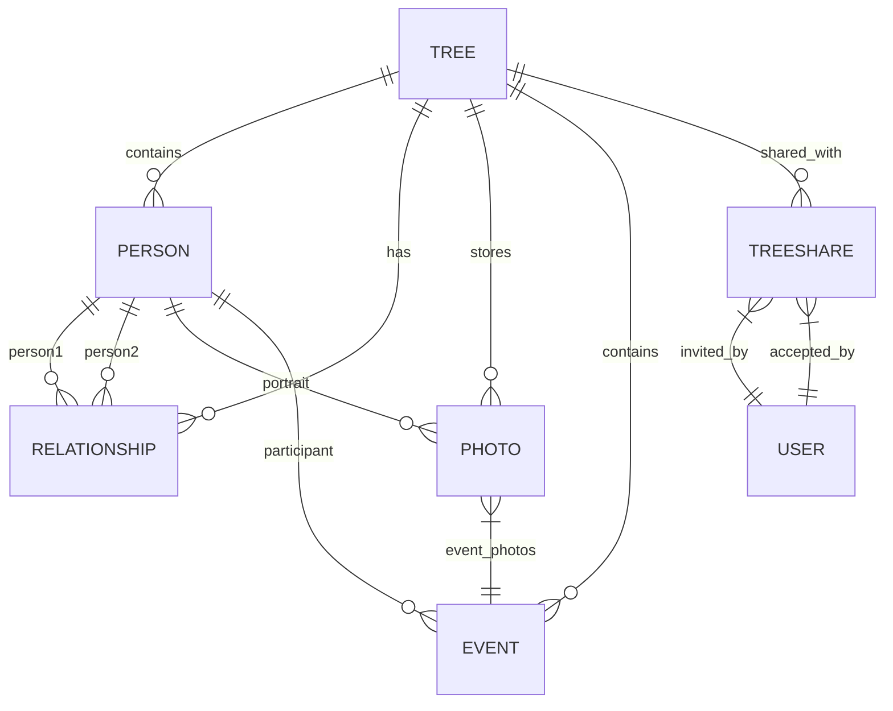

# DATA-MODEL.md

## Modelo de Datos - ARBOL-GEN-PRO

Este documento define las entidades, sus relaciones, restricciones y el esquema de base de datos para IndexedDB (Dexie.js) y PostgreSQL (Supabase).

---

## Tipos Base

```typescript
// shared/types/common.ts

type SyncStatus = 'synced' | 'pending' | 'conflict' | 'error';

type UUID = string;  // Formato UUID v7 (timestamp + random)

interface BaseEntity {
  id: UUID;
  createdAt: number;
  updatedAt: number;
  version: number;
  syncStatus: SyncStatus;
  localOnly?: boolean;
}

interface Result<T, E = AppError> {
  ok: boolean;
  value?: T;
  error?: E;
}

class AppError extends Error {
  constructor(
    message: string,
    public code: string,
    public statusCode?: number
  ) {
    super(message);
    this.name = 'AppError';
  }
}
```

### PartialDate (Fecha Parcial)

```typescript
interface PartialDate {
  year: number;                  // Obligatorio
## Relaciones y Restricciones

### Diagrama Entidad-Relación (Mermaid)



### Constraints de Negocio

| Entidad | Constraint | Descripción |
|---------|------------|-------------|
| Person | `treeId` + `id` único | Una persona pertenece a un solo árbol |
| Relationship | `person1Id` + `person2Id` distintos | No auto-relación |
| Relationship | Tipo `parent-child` → `person1` es padre/madre | Dirección semántica |
| Person | `isLiving` = true si no hay `deathDate` | Calculado, no almacenado por separado |
| Photo | `original.r2Key` único | No duplicados en R2 |
| TreeShare | `treeId` + `invitedEmail` único | Una invitación pendiente por email |
| SyncOutbox | `id` (eventId) único | Idempotencia garantizada |

### Índices Recomendados (PostgreSQL / Dexie)

```sql
-- PostgreSQL (Supabase)
CREATE INDEX idx_person_tree_id ON person(tree_id);
CREATE INDEX idx_person_name ON person USING gin(to_tsvector('spanish', first_name || ' ' || last_name)));
CREATE INDEX idx_relationship_tree ON relationship(tree_id);
CREATE INDEX idx_relationship_persons ON relationship(person1_id, person2_id);
CREATE INDEX idx_photo_tree ON photo(tree_id);
CREATE INDEX idx_photo_person ON photo(person_id);
CREATE INDEX idx_event_tree ON event(tree_id);
CREATE INDEX idx_tree_share_tree ON tree_share(tree_id);
CREATE INDEX idx_tree_share_token ON tree_share(token);
CREATE INDEX idx_syncoutbox_status ON sync_outbox(status);
CREATE INDEX idx_syncoutbox_entity ON sync_outbox(entity_type, entity_id);

-- Dexie.js (IndexedDB) - definido en stores
```

## Esquema Dexie.js (IndexedDB)

```typescript
// core/db/schema.ts
import { Dexie, type Table } from 'dexie';

export const db = new Dexie('arbol-gen-pro');

db.version(1).stores({
  trees: 'id, name, ownerId, createdAt, updatedAt, version, syncStatus, localOnly',
  persons: 'id, treeId, firstName, lastName, sex, isLiving, createdAt, updatedAt, version, syncStatus, localOnly',
  relationships: 'id, treeId, person1Id, person2Id, type, createdAt, updatedAt, version, syncStatus, localOnly',
  photos: 'id, treeId, personId, eventId, createdAt, updatedAt, version, syncStatus, localOnly',
  events: 'id, treeId, type, createdAt, updatedAt, version, syncStatus, localOnly',
  treeShares: 'id, treeId, invitedEmail, token, status, createdAt, updatedAt, version, syncStatus',
  syncOutbox: 'id, entityType, entityId, operation, timestamp, status, retryCount',
  // Store para blobs de fotos (miniaturas, optimizadas)
  photoBlobs: 'id, photoId, version, blob'
});
```

## Migraciones de Esquema

| Versión | Cambios |
|---------|---------|
| 1 | Esquema inicial (trees, persons, relationships, photos, events, treeShares, syncOutbox, photoBlobs) |
| 2 | *Futuro*: Agregar `vectorClock` a `syncOutbox` |
| 3 | *Futuro*: Agregar `branchRestriction` a `treeShares` |

## Versionado y Control de Concurrencia

Cada entidad tiene:
- **version**: Incrementa en cada actualización local (integer)
- **syncStatus**: Rastrea estado sincronización
- **vectorClock**: En `SyncOutbox` para detectar conflictos distribuidos

**Regla**: Nunca sobrescribir entidad si `version` local ≠ `version` servidor sin resolución de conflicto.

## Tipos Compartidos

```typescript
// shared/types/common.ts

type SyncStatus = 'synced' | 'pending' | 'conflict' | 'error';

type UUID = string;  // Formato UUID v7 (timestamp + random)

interface BaseEntity {
  id: UUID;
  createdAt: number;
  updatedAt: number;
  version: number;
  syncStatus: SyncStatus;
  localOnly?: boolean;
}

interface Result<T, E = AppError> {
  ok: boolean;
  value?: T;
  error?: E;
}

class AppError extends Error {
  constructor(
    message: string,
    public code: string,
    public statusCode?: number
  ) {
    super(message);
    this.name = 'AppError';
  }
}
```

---

*Modelo de datos de ARBOL-GEN-PRO*
*Versión 1.0*
*Compatible con IndexedDB (Dexie.js) y PostgreSQL (Supabase)*
  month?: number;                // 1-12
  day?: number;                  // 1-31
  qualifier?: 'circa' | 'before' | 'after';
  rangeEnd?: PartialDate;        // Para rangos (ej. 1900-1910)
  calendar?: 'gregorian' | 'julian' | 'hebrew' | 'islamic';
}
```

### Place (Lugar)

```typescript
interface Place {
  name: string;                  // Nombre completo del lugar
  city?: string;
  parish?: string;
  region?: string;               // Estado, provincia
  country?: string;              // Código ISO 3166-1 alpha-2
  coordinates?: [number, number]; // [lat, lng]
  geonamesId?: string;
}
```