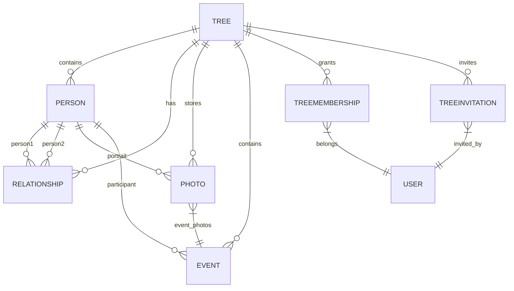

# DATA-MODEL.md

## Modelo de Datos - ARBOL-GEN-PRO

Este documento define las entidades, sus relaciones, restricciones y el esquema de base de datos para IndexedDB (Dexie.js) y PostgreSQL (Supabase).

> **Reconciliado con `SYNC-ARCHITECTURE.md`** (ROADMAP.md, Fase 1). La terminología de versiones e identidad de operaciones es ahora **idéntica** en ambos documentos. En caso de duda, manda `SYNC-ARCHITECTURE.md` para todo lo relativo a sincronización.

---

## Tipos Base

```typescript
// shared/types/common.ts

type SyncStatus = 'synced' | 'pending' | 'conflict' | 'error';

type UUID = string;  // Formato UUID v7 (timestamp + random)

/**
 * Campos comunes a toda entidad sincronizable.
 *
 * `serverVersion` y `localRevision` NO son intercambiables:
 * - `serverVersion` solo lo incrementa el SERVIDOR.
 * - `localRevision` solo lo incrementa el CLIENTE.
 * Ver "Versionado y Control de Concurrencia".
 */
interface BaseEntity {
  id: UUID;
  createdAt: number;        // Informativo: reloj local, no ordena nada
  updatedAt: number;        // Informativo: reloj local, no ordena nada
  serverVersion: number;    // Solo el servidor lo incrementa
  localRevision: number;    // Solo el cliente lo incrementa
  syncStatus: SyncStatus;   // Estado de la última escritura local
  deletedAt: number | null; // Tombstone. null = la entidad existe
  localOnly?: boolean;      // Creada solo en este dispositivo, nunca sube
}

interface Result<T, E = AppError> {
  ok: boolean;
  value?: T;
  error?: E;
}

class AppError extends Error {
  constructor(
    message: string,
    public code: string,
    public statusCode?: number
  ) {
    super(message);
    this.name = 'AppError';
  }
}
```

### PartialDate (Fecha Parcial)

```typescript
interface PartialDate {
  year: number;                  // Obligatorio
  month?: number;                // 1-12
  day?: number;                  // 1-31
  qualifier?: 'circa' | 'before' | 'after';
  rangeEnd?: PartialDate;        // Para rangos (ej. 1900-1910)
  calendar?: 'gregorian' | 'julian' | 'hebrew' | 'islamic';
}
```

### Place (Lugar)

```typescript
interface Place {
  name: string;                  // Nombre completo del lugar
  city?: string;
  parish?: string;
  region?: string;               // Estado, provincia
  country?: string;              // Código ISO 3166-1 alpha-2
  coordinates?: [number, number]; // [lat, lng]
  geonamesId?: string;
}
```

---

## Entidades

### Tree (Árbol genealógico)

```typescript
interface Tree extends BaseEntity {
  name: string;
  description?: string;
  ownerId: UUID;
}
```

### Person (Persona)

```typescript
/**
 * Estado de vida. Deliberadamente explícito: NUNCA se infiere a partir
 * de la ausencia de `deathDate`. Una persona de la que no se sabe si
 * falleció es 'unknown', no 'alive'.
 */
type LifeStatus = 'alive' | 'deceased' | 'unknown';

interface Person extends BaseEntity {
  treeId: UUID;
  firstName: string;
  lastName?: string;
  sex?: 'male' | 'female' | 'other' | 'unknown';
  birthDate?: PartialDate;
  deathDate?: PartialDate;
  lifeStatus: LifeStatus;
  birthplace?: Place;
  deathPlace?: Place;
  biography?: string;
  notes?: string;
  generation?: number;
}
```

### Relationship (Relación familiar)

```typescript
type RelationshipType =
  | 'parent-child'
  | 'spouse'
  | 'sibling'
  | 'adoptive'
  | 'stepparent'
  | 'guardian'
  | 'partner';

interface Relationship extends BaseEntity {
  treeId: UUID;
  person1Id: UUID;
  person2Id: UUID;
  type: RelationshipType;
  startDate?: PartialDate;
  endDate?: PartialDate;
}
```

### Event (Evento de vida)

```typescript
type EventType =
  | 'birth' | 'baptism' | 'marriage' | 'death' | 'burial'
  | 'education' | 'occupation' | 'military' | 'immigration' | 'other';

interface Event extends BaseEntity {
  treeId: UUID;
  personIds: UUID[];
  type: EventType;
  title?: string;
  date?: PartialDate;
  place?: Place;
  description?: string;
}
```

### Photo (Fotografía)

```typescript
type PhotoKind = 'original' | 'optimized' | 'thumbnail';

interface Photo extends BaseEntity {
  treeId: UUID;
  personId?: UUID;
  eventId?: UUID;
  r2Key: string;          // Clave del ORIGINAL en R2 (bucket privado)
  kind?: PhotoKind;       // Solo para blobs locales (photoBlobs)
  width: number;
  height: number;
  mimeType: string;
  sizeBytes: number;
  isPrimary: boolean;     // Retrato principal de la persona
  capturedAt?: number;
  exif?: Record<string, string | number>;
}
```

### TreeMembership (Membresía) y TreeInvitation (Invitación)

Son **entidades distintas**. La invitación es temporal y lleva un token; la membresía es permanente y referencia a un usuario ya autenticado.

```typescript
/**
 * Roles. El conjunto final está pendiente de decisión (F3 en ROADMAP.md):
 * `REQUIREMENTS.md` RF-09.2 enumera los cinco, mientras que
 * `SYNC-ARCHITECTURE.md` §17.1 asume `owner`, `editor` y `viewer`.
 */
type TreeRole = 'owner' | 'admin' | 'editor' | 'viewer' | 'commenter';

interface TreeMembership extends BaseEntity {
  treeId: UUID;
  userId: UUID;
  role: TreeRole;
  invitedBy?: UUID;
  acceptedAt?: number;
}

interface TreeInvitation extends BaseEntity {
  treeId: UUID;
  invitedEmail: string;
  role: TreeRole;
  tokenHash: string;      // Hash del token. El token en claro NUNCA se guarda
  expiresAt: number;      // Caducidad
  acceptedAt?: number;
  acceptedBy?: UUID;
  revokedAt?: number;
}
```

---

## SyncOperation (Operación de la cola local)

La cola local vive en el store Dexie `syncOutbox`. **No es la tabla del servidor**: el servidor mantiene un registro distinto de operaciones ya procesadas (§10.1 de `SYNC-ARCHITECTURE.md`).

```typescript
type OperationType = 'create' | 'update' | 'delete';

type OperationStatus =
  | 'pending'     // Encolada, todavía no enviada
  | 'in_flight'   // Enviada, se espera la respuesta
  | 'confirmed'   // El servidor confirmó (applied / alreadyProcessed)
  | 'failed'      // Error permanente o intentos agotados. Se conserva
  | 'blocked';    // Conflicto (409) pendiente de decisión del usuario

type EntityType =
  | 'tree' | 'person' | 'relationship' | 'event' | 'photo'
  | 'treeMembership' | 'treeInvitation';

interface SyncOperation {
  operationId: UUID;                    // CLAVE PRIMARIA. Clave de idempotencia
  entityType: EntityType;
  entityId: UUID;
  operationType: OperationType;
  baseServerVersion: number;            // 0 = la entidad aún no existe en el servidor
  payload: Record<string, unknown> | null; // null en 'delete'
  createdAt: number;                    // Informativo: el orden real lo fijan la cola y dependsOn
  status: OperationStatus;
  retryCount: number;
  lastError: string | null;             // Sin datos personales
  dependsOn: UUID[];                    // Operaciones que deben confirmarse antes
}
```

> `operationId` es la **única** clave. No existe un `id` adicional ni un `eventId`: dos identificadores para la misma operación obligarían a decidir cuál es la clave y complicarían la deduplicación en el servidor.

---

## Diagrama Entidad-Relación (Mermaid)



### Constraints de Negocio

| Entidad | Constraint | Descripción |
|---------|------------|-------------|
| Person | `treeId` + `id` único | Una persona pertenece a un solo árbol |
| Person | `lifeStatus = 'deceased'` exige `deathDate` | Nunca se infiere el estado de vida por la ausencia de fecha |
| Person | `lifeStatus = 'alive'` prohíbe `deathDate` | Una persona viva no tiene fecha de fallecimiento |
| Relationship | `person1Id` + `person2Id` distintos | No auto-relación |
| Relationship | Tipo `parent-child` → `person1` es padre/madre | Dirección semántica |
| Photo | `original.r2Key` único | No duplicados en R2 |
| TreeMembership | `treeId` + `userId` único | Una membresía por usuario y árbol |
| TreeInvitation | `treeId` + `invitedEmail` único | Una invitación pendiente por email |
| TreeInvitation | `tokenHash` único y con `expiresAt` | El token en claro nunca se almacena |
| SyncOperation | `operationId` (UUID v7) único | Idempotencia garantizada |


### Índices Recomendados (PostgreSQL / Dexie)

```sql
-- PostgreSQL (Supabase)
CREATE INDEX idx_person_tree_id ON person(tree_id);
CREATE INDEX idx_person_name ON person USING gin(to_tsvector('spanish', first_name || ' ' || last_name));
CREATE INDEX idx_person_life_status ON person(life_status);
CREATE INDEX idx_relationship_tree ON relationship(tree_id);
CREATE INDEX idx_relationship_persons ON relationship(person1_id, person2_id);
CREATE INDEX idx_photo_tree ON photo(tree_id);
CREATE INDEX idx_photo_person ON photo(person_id);
CREATE INDEX idx_event_tree ON event(tree_id);
CREATE INDEX idx_tree_membership_tree ON tree_membership(tree_id);
CREATE INDEX idx_tree_membership_user ON tree_membership(user_id);
CREATE INDEX idx_tree_invitation_tree ON tree_invitation(tree_id);
CREATE INDEX idx_tree_invitation_token_hash ON tree_invitation(token_hash);

-- Registro de operaciones ya procesadas (servidor).
-- NO es la cola local: aquí solo se guardan las operaciones YA aplicadas,
-- para poder responder 'alreadyProcessed' ante un reintento.
CREATE INDEX idx_sync_operation_user ON sync_operation(user_id);
CREATE INDEX idx_sync_operation_entity ON sync_operation(entity_type, entity_id);
CREATE INDEX idx_sync_operation_processed ON sync_operation(processed_at);

-- Dexie.js (IndexedDB) - definido en stores
```

---

## Esquema Dexie.js (IndexedDB)

```typescript
// core/db/schema.ts
import { Dexie, type Table } from 'dexie';

export const db = new Dexie('arbol-gen-pro');

db.version(1).stores({
  trees: 'id, name, ownerId, createdAt, updatedAt, serverVersion, syncStatus, deletedAt',
  persons: 'id, treeId, firstName, lastName, lifeStatus, createdAt, updatedAt, serverVersion, syncStatus, deletedAt',
  relationships: 'id, treeId, person1Id, person2Id, type, createdAt, updatedAt, serverVersion, syncStatus, deletedAt',
  events: 'id, treeId, type, createdAt, updatedAt, serverVersion, syncStatus, deletedAt',
  photos: 'id, treeId, personId, eventId, r2Key, createdAt, updatedAt, serverVersion, syncStatus, deletedAt',
  treeMemberships: 'id, treeId, userId, role, createdAt, updatedAt, serverVersion, syncStatus',
  treeInvitations: 'id, treeId, invitedEmail, tokenHash, expiresAt, createdAt, updatedAt',
  // Cola local de operaciones. Clave primaria: operationId.
  syncOutbox: 'operationId, status, [entityType+entityId], createdAt',
  // Blobs de fotos locales (miniaturas, optimizadas). El original vive en R2.
  photoBlobs: 'id, photoId, kind',
});
```

**Notas sobre los índices:**

---

## Migraciones de Esquema

| Versión | Cambios |
|---------|---------|
| 1 | Esquema inicial (trees, persons, relationships, events, photos, treeMemberships, treeInvitations, syncOutbox, photoBlobs) |
| 2 | *Futuro, condicionado a `SYNC-ARCHITECTURE.md` §3.3*: añadir `vectorClock` a `syncOutbox`. **No forma parte del MVP** (ver "Vector clocks" más abajo) |
| 3 | *Futuro*: añadir `branchRestriction` a `treeMemberships` |

### Vector clocks

Los vector clocks **no se implementan en el MVP**. El control de concurrencia usa control optimista con `serverVersion` verificado por el servidor. La decisión, sus criterios de reevaluación y la ruta de migración están en `SYNC-ARCHITECTURE.md` §3.

---

## Versionado y Control de Concurrencia

Cada entidad tiene:

- **serverVersion**: entero monotónico que **solo incrementa el servidor**. Es el valor contra el que se decide el control de concurrencia.
- **localRevision**: contador que **solo incrementa el cliente** en cada escritura local. Distingue escrituras sucesivas sobre la misma entidad dentro de un mismo dispositivo. Nunca se usa como criterio de conflicto.
- **syncStatus**: rastrea el estado de la última escritura local (`synced` / `pending` / `conflict` / `error`).
- **deletedAt**: marca de borrado lógico (tombstone). `null` significa que la entidad existe.

La cola local añade:

- **operationId**: identificador global y único de la operación. Es la clave de idempotencia.
- **baseServerVersion**: copia del `serverVersion` que el cliente creyó vigente al encolar la operación. Es la base de la comparación contra el servidor.
- **dependsOn**: `operationId`s que deben confirmarse antes que esta operación.

**Reglas:**

1. El cliente **nunca** incrementa `serverVersion`. Solo lo actualiza cuando el servidor confirma una operación (`applied` o `alreadyProcessed`).
2. El servidor **nunca** escribe `localRevision`.
3. Nunca se sobrescribe una entidad si `baseServerVersion` ≠ `serverVersion` del servidor, sin resolución explícita del conflicto.
4. El borrado es **lógico**: se establece `deletedAt` y se conserva la entidad hasta la purga (§13.5 de `SYNC-ARCHITECTURE.md`).

### Nombres canónicos

Estos cinco campos tienen **un único nombre y un único dueño** en todo el proyecto:

| Campo | Dónde vive | Quién lo modifica | Qué representa |
|-------|-----------|-------------------|----------------|
| `serverVersion` | Entidad | Solo el servidor | Versión autoritativa del registro. Base del control de concurrencia. |
| `localRevision` | Entidad | Solo el cliente | Contador local de escrituras sobre la misma entidad. |
| `syncStatus` | Entidad | Solo el cliente | Estado de la última escritura local de esa entidad. |
| `operationId` | Operación (`syncOutbox`) | Solo el cliente | Identidad global de la operación. Clave de idempotencia. |
| `dependsOn` | Operación (`syncOutbox`) | Solo el cliente | Operaciones que deben confirmarse antes que esta. |

> `syncStatus` (entidad) y `status` (operación) son cosas distintas: el primero describe la última escritura local de una entidad; el segundo, el estado de sincronización de una operación. No deben confundirse.

---

*Modelo de datos de ARBOL-GEN-PRO*
*Versión 2.0 — reconciliado con `SYNC-ARCHITECTURE.md` (ROADMAP.md, Fase 1)*
*Compatible con IndexedDB (Dexie.js) y PostgreSQL (Supabase)*


- `syncOutbox` se indexa por `operationId` (clave primaria), por `status` (recuperar pendientes y fallidas), por el compuesto `[entityType+entityId]` (operaciones que afectan a una entidad) y por `createdAt` (ordenación cronológica de la cola).
- El índice `[entityType+entityId]` **no garantiza unicidad**: ese papel es de `operationId`.
- `localRevision` **no se indexa**: nunca se consulta, solo se usa para detectar escrituras locales encadenadas.
- `deletedAt` se indexa para localizar tombstones pendientes de purga.

