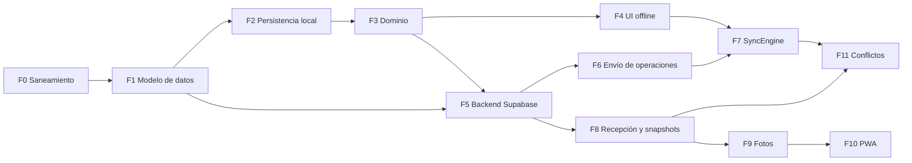

# ROADMAP.md

Plan de implementación verificable para ARBOL-GEN-PRO. Orden por complejidad: **persistencia local** primero, después sincronización remota, exactamente como exige `SYNC-ARCHITECTURE.md`.

## Notas de contexto (verificado sobre el repositorio)

| Elemento | Estado real |
|---|---|
| `src/` | Scaffold puro Vite+React19+TS; `src/App.tsx` es la plantilla Vite ("Get started"). Sin dominio funcional. |
| `package.json` | Deps: `dexie`, `browser-image-compression`. DevDeps incluyen `vitest`, `@testing-library/*`, `jsdom`, `vite-plugin-pwa`, `oxlint`. **Faltan**: script `test`, `@supabase/supabase-js`, `fake-indexeddb`, PWA configurada. |
| `tsconfig.app.json` | `noUnusedLocals/Parameters`, `verbatimModuleSyntax`, pero **no** `strict: true` (RNF-06.2 lo pide). |
| `.env` | Contiene `OPENROUTER_API_KEY`; no hay `.env.example`; `.env` **no está en `.gitignore`**. |
| `README.md` | Enlaza `IMPLEMENTATION-ROADMAP.md`, `STORAGE-STRATEGY.md` y `SECURITY.md`, todos **inexistentes**. |
| Docs | `DATA-MODEL.md`, `ARCHITECTURE.md`, `REQUIREMENTS.md`, `SYNC-ARCHITECTURE.md`, `AI-CONTEXT.md` existen. |

Las soluciones mínimas de los cinco puntos anteriores se aplican en **Fase 0**. Las discrepancias `DATA-MODEL.md` ↔ `SYNC-ARCHITECTURE.md` (D1–D12) se derivan de `SYNC-ARCHITECTURE.md` §20 y se corrigen en **Fase 1**.

## Comprensión del problema

Para qué: una app offline-first para árbol genealógico familiar con Dexie + Supabase, sincronización por **operación**, control optimista de concurrencia y resolución manual de conflictos (ningún auto-merge silencioso), e idempotencia ante reintentos. El roadmap empieza donde el diseño lo exige: **persistencia local (Fase 2)**, no el backend.

## Mapeo Requisito → Fase

| RF | Función | Fase que lo entrega |
|---|---|---|
| RF-01 | Árboles (CRUD) | F5 |
| RF-02 | Personas (CRUD + búsqueda) | F3 |
| RF-03 | Relaciones familiares | F3 |
| RF-04 | Profundidad generacional | F4 |
| RF-05 | Fechas, lugares, biografías | F3 + F11 |
| RF-06 | Fotografías | F9 |
| RF-07 | Perfiles + búsqueda | F4 + F11 |
| RF-09 | Compartir y permisos | F5 (RLS) + F6 |
| RF-10 | Offline-first | F2, F3, F4 |
| RF-11 | Sincronización y conflictos | F6, F7, F8 |
| RF-12 | Idempotencia | F6 |
| RF-13 | Estado de sincronización | F4 |
| RF-14 | PWA instalable | F10 |

> **Nota de coherencia**: RF-09.2 enumera los roles `owner, admin, editor, viewer, commenter`, mientras que `SYNC-ARCHITECTURE.md` §17.1 asume `owner, editor, viewer`. El conjunto final de roles es la decisión funcional F3 (§4 de este documento) y debe cerrarse **antes** de implementar la Fase 5, porque de él dependen las políticas RLS.

## Reglas de ejecución

1. **Una fase termina o no existe.** Cada fase declara un criterio de aceptación comprobable con un comando. Si el comando falla, la fase no está terminada.
2. **No se empieza la Fase N+1 con la N a medias.** El orden es una cadena: F2 → F3 → F5 → F6 → F7.
3. **Ninguna fase rompe una anterior.** Si una fase posterior obliga a cambiar el modelo de datos, se revisa la Fase 1 y se documenta en `SYNC-ARCHITECTURE.md` §20 antes de continuar.
4. **Cada fase deja el proyecto en verde**: `npm run lint`, `npm run build` y `npm run test` sin errores.

---

## Fase 0 — Saneamiento del scaffold

**Objetivo**: que el repositorio sea una base verificable antes de escribir una línea de dominio. Hoy el proyecto no tiene forma de comprobar nada: no hay script de test, no hay `strict`, y el README promete scripts y documentos que no existen.

**Alcance**: configuración, no funcionalidad.

| # | Tarea | Verificación |
|---|---|---|
| 0.1 | Añadir script `"test": "vitest run"` a `package.json`. | `npm run test` no falla por script inexistente. |
| 0.2 | Añadir `"strict": true` a `tsconfig.app.json` (RNF-06.2). | `npx tsc -b --noEmit` sin errores. |
| 0.3 | Crear `.env.example` con `VITE_SUPABASE_URL` y `VITE_SUPABASE_ANON_KEY` (valores de ejemplo). | `.env.example` existe y `.env` sigue ignorado. |
| 0.4 | Añadir `.env` y `.env.local` a `.gitignore`. | `git check-ignore .env` devuelve coincidencia. |
| 0.5 | Enlazar `README.md` a `ROADMAP.md` y marcar como pendientes `STORAGE-STRATEGY.md` y `SECURITY.md`. | Ningún enlace del README apunta a un archivo inexistente sin estar anotado. |
| 0.6 | Instalar `fake-indexeddb` como devDep. | `node -e "require.resolve('fake-indexeddb')"` resuelve. |

**Criterio de aceptación**:
- `npm run lint` → 0 errores.
- `npm run build` → 0 errores.
- `npm run test` → ejecuta y reporta (aunque aún no haya tests, debe salir con código 0 y un mensaje claro, no "no test found" fallando).

**Nota de seguridad**: el `.env` actual contiene una clave de OpenRouter que **no pertenece a este proyecto**. No se toca en esta fase (no es alcance de roadmap), pero se deja constancia en §4 (F8).

**Por qué es la primera fase**: sin `strict` ni runner de tests, cada fase posterior entregaría algo no verificable. Es el prerrequisito de la verificabilidad que exige el objetivo del proyecto.

---

## Fase 1 — Modelo de datos reconciliado

**Objetivo**: que `DATA-MODEL.md` y `SYNC-ARCHITECTURE.md` describan **la misma** base de datos. Hoy se contradicen en campos que la sincronización necesita (D1–D12 de `SYNC-ARCHITECTURE.md` §20.2).

**Alcance**: solo documentación. No se escribe código.

| # | Discrepancia | Acción | Prioridad |
|---|---|---|---|
| 1.1 | **D1** — `syncOutbox` usa `id`/`eventId` como clave primaria. | Renombrar la clave a `operationId` y añadir `baseServerVersion`, `operationType`, `payload`, `lastError`, `dependsOn`. Eliminar `id`/`eventId` del modelo del outbox. | **Crítica** |
| 1.2 | **D3** — `version` "incrementa en cada actualización local". | Separar en `serverVersion` (solo el servidor) y `localRevision` (solo el cliente), con la regla de §2.1 de `SYNC-ARCHITECTURE.md`. | **Crítica** |
| 1.3 | **D2** — `vectorClock` como principio activo. | Marcarlo como evolución futura condicionada a §3.3; eliminarlo de las migraciones previstas. | Alta |
| 1.4 | **D4** — sin campo de tombstone. | Añadir `deletedAt: number \| null` a las entidades eliminables (§13.2). | Alta |
| 1.5 | **D5** — `isLiving` inferido de la ausencia de `deathDate`. | Separar el estado de vida (`alive` / `deceased` / `unknown`) de la fecha de fallecimiento. | Alta |
| 1.6 | **D6** — sin `dependsOn`. | Añadir `dependsOn: string[]` al store `syncOutbox` (§14.2). | Media |
| 1.7 | **D7–D10** — coherencia con `ARCHITECTURE.md` y `AI-CONTEXT.md`. | Eliminar *Last-Write-Wins*, unificar `operationId`/`operationType`/`createdAt`, y resolver la ambigüedad lote-vs-operación. | Alta / Media |
| 1.8 | **D11, D12** — orden del documento e invitaciones. | Reordenar `DATA-MODEL.md` y separar `TreeInvitation` de la membresía (token con hash y caducidad). | Media |

**Criterio de aceptación**:
- Los cinco campos en conflicto tienen **un único nombre y un único dueño** en los dos documentos: `serverVersion`, `localRevision`, `syncStatus`, `operationId`, `dependsOn`.
- Una búsqueda de `id`/`eventId` en la definición de `syncOutbox` no devuelve resultados.
- Una búsqueda de `vectorClock` solo aparece marcada como "evolución futura".
- `SYNC-ARCHITECTURE.md` §20.2 se actualiza para reflejar las discrepancias ya resueltas (quedan solo D7–D12 si alguna se difiere).

**Depende de**: Fase 0 (para poder verificar con tipos).
**Bloquea a**: Fases 2, 3, 5 y 6. Es la fase que más retrabajo evita.

---

## Fase 2 — Persistencia local (IndexedDB / Dexie)

**Objetivo**: que el dispositivo sea la fuente de verdad de la sesión (P1). Implementar el esquema local completo, con la regla transaccional de §7.1 de `SYNC-ARCHITECTURE.md`: **entidad y operación se escriben juntas o no se escribe ninguna**.

**Es la primera fase de funcionalidad** y el punto de partida acordado: persistencia local antes de sincronización remota.

| # | Tarea | Detalle |
|---|---|---|
| 2.1 | Definir el esquema Dexie | Stores `tree`, `person`, `relationship`, `photo`, `event`, `syncOutbox`, `photoBlobs`. Índices según `DATA-MODEL.md` ya reconciliado (Fase 1). |
| 2.2 | Implementar `syncOutbox` con `operationId` como clave primaria | Índice `status`, índice compuesto `[entityType+entityId]`, índice `createdAt` (§5.1). |
| 2.3 | Implementar la escritura transaccional | Un único `db.transaction('rw', ...)` que escribe entidad **y** operación. Si falla, no queda nada escrito (§7.1). |
| 2.4 | Calcular `baseServerVersion` y `localRevision` al encolar | `create` → `0`; `update`/`delete` → `serverVersion` conocido (§2.2). `localRevision` +1 en cada escritura local (§7.3). |
| 2.5 | Generar `operationId` como UUID v7 | Sin dependencia de `crypto.randomUUID` (que es v4). Requiere implementación propia o dependencia explícita (§2.3). |
| 2.6 | Implementar `dependsOn` | Registrar `operationId`s de los que depende cada operación (§14.2). |
| 2.7 | Tests con `fake-indexeddb` | Atomicidad (2.3), persistencia, índices, `baseServerVersion` por tipo de operación (§18.2). |

**Criterio de aceptación**:
- `npm run test` pasa con los tests de atomicidad de §18.2 en verde.
- Un test demuestra que, si la escritura de la operación falla, **la entidad tampoco queda escrita**.
- Un test demuestra que `serverVersion` **no** lo modifica nunca el cliente (§2.1).
- Un test demuestra que `localRevision` se incrementa en cada escritura local.

**Depende de**: Fase 1.
**Bloquea a**: Fases 3, 4, 6, 7.

---

## Fase 3 — Dominio y repositorios locales

**Objetivo**: la lógica de negocio sobre los datos locales, sin una sola línea de red. La UI no debe saber que existe un servidor.

| # | Tarea | Detalle |
|---|---|---|
| 3.1 | Interfaces de repositorio | Una por entidad (`person`, `relationship`, `event`, `photo`, `tree`). Contrato local primero; el remoto se añade después como otra implementación. |
| 3.2 | Validación de reglas de negocio | Coherencia de relaciones, no ciclos (RF-03.6), fechas lógicas, lugares jerárquicos. |
| 3.3 | Fechas parciales y rangos | Tipo `PartialDate` con precisión (`year`, `year-month`, `exact`), "circa", "antes de", "después de" (RF-05.1). |
| 3.4 | Búsqueda y filtrado | Búsqueda por nombre, fechas, lugares y texto libre (RF-02.4, RF-08.1). |
| 3.5 | Tests de dominio | Reglas de negocio puras, sin IndexedDB: se ejecutan rápido y localizan los fallos. |

**Criterio de aceptación**:
- Los repositorios no importan nada de red. Verificable por inspección del grafo de imports.
- `npm run test` pasa con los tests de dominio en verde.
- Las reglas de RF-03.6 (no ciclos) están cubiertas por al menos un test que falla si se rompe la regla.

**Depende de**: Fase 2.
**Bloquea a**: Fases 4, 5, 8, 11.

---

## Fase 4 — UI offline y estado de sincronización

**Objetivo**: que la aplicación sea usable de principio a fin **sin red**, y que el usuario sepa en todo momento en qué estado está su trabajo.

| # | Tarea | Detalle |
|---|---|---|
| 4.1 | CRUD completo sobre repositorios locales | Personas, relaciones, eventos, árboles. Toda operación pasa por la transacción de la Fase 2. |
| 4.2 | Indicador global de estado | `synced` / `pending` / `conflict` / `error` en el header (RF-13.1). |
| 4.3 | Detalle por entidad | Botón "Ver conflictos" en perfiles con conflicto (RF-13.2). |
| 4.4 | Botón "Sincronizar ahora" | Dispara el motor de forma manual (RF-10.5). En esta fase solo informa que no hay backend; en la Fase 7 se conecta. |
| 4.5 | Modo offline real | Desconectar la red y operar: la UI responde igual. |

**Criterio de aceptación**:
- Con la red desconectada, se puede crear, editar y eliminar una persona, una relación y un evento, y la UI refleja el cambio tras confirmar IndexedDB (§7.2).
- El indicador global refleja el estado real de la cola.
- `npm run test` y `npm run build` en verde.

**Depende de**: Fase 3.
**Bloquea a**: Fase 7 (el motor necesita la UI que dispara), Fase 8.

---

## Fase 5 — Backend Supabase (esquema, RLS, autenticación)

**Objetivo**: el lado servidor que valida y decide. El cliente no es fuente de autoridad (P10).

| # | Tarea | Detalle |
|---|---|---|
| 5.1 | Esquema PostgreSQL | Tablas del `DATA-MODEL.md` reconciliado, con `serverVersion` por fila y `deletedAt` para tombstones. |
| 5.2 | Tabla de operaciones procesadas | `operation_id` como **clave primaria** (§10.1). Es la garantía de idempotencia. |
| 5.3 | RLS al 100 % de las tablas | RNF-03.1. El `treeId` se deriva de la entidad, nunca del cliente (§9.3, punto 2). |
| 5.4 | Roles y permisos | Aplicar el conjunto de roles que se cierre en F3 (§4). `viewer` no escribe. |
| 5.5 | Autenticación | Supabase Auth. El `userId` lo extrae el servidor del JWT, nunca del cuerpo de la petición. |
| 5.6 | Endpoint `POST /sync` | Edge Function. Verifica identidad → autorización → idempotencia → versión base → aplica en una **única transacción** (§9.3). |
| 5.7 | Modo de incrementación de `serverVersion` | El servidor es el único que lo incrementa. `create` → `1`; `update`/`delete` → `+1` (§2.1). |
| 5.8 | Pruebas de contrato | Los seis casos de §18.3: idempotencia, simultaneidad, concurrencia, autorización, no filtración, borrado remoto. |

**Criterio de aceptación**:
- Dos peticiones con el mismo `operationId` producen **un solo** efecto.
- Con `baseServerVersion` desfasado, el servidor devuelve `409` y **no** escribe.
- Un `409` para un solicitante sin permiso no incluye el snapshot del servidor (§17.5).
- Un usuario `viewer` no puede escribir.
- La mutación y el registro de la operación se confirman en la **misma** transacción.

**Depende de**: Fase 1 (esquema) y Fase 3 (reglas de negocio que el servidor también debe validar).
**Bloquea a**: Fases 6, 7, 8.

**Nota**: esta fase requiere que el proyecto de Supabase exista. Es la primera fase con dependencia de infraestructura externa.

---

## Fase 6 — Sincronización remota: envío de operaciones

**Objetivo**: que la cola local llegue al servidor de forma **idempotente, reintentable y auditable**. Esta es la fase donde el trabajo offline se convierte en trabajo compartido.

| # | Tarea | Detalle |
|---|---|---|
| 6.1 | Cliente HTTP del protocolo | `POST /sync` con `Authorization: Bearer`, `Idempotency-Key: operationId` y el cuerpo de §9.1. |
| 6.2 | Envío en orden topológico | Las operaciones dependientes se envían cuando sus `dependsOn` están confirmadas (§14.3). Ciclos → `blocked`. |
| 6.3 | Clasificación de respuestas | Cada código HTTP lleva al estado local correcto (§12.1): `confirmed`, `failed`, `blocked`, `pending` con reintento. |
| 6.4 | Backoff exponencial con jitter | Respeta el tope de 5 reintentos (RF-11.5) y añade jitter (§12.3). |
| 6.5 | Actualización de `serverVersion` | Solo con ACK del servidor (`applied` o `alreadyProcessed`). Nunca por otra vía (§2.1). |
| 6.6 | Recuperación de respuesta perdida | Reintento con el **mismo** `operationId` → el servidor responde `alreadyProcessed` (§8.4). |
| 6.7 | Conservación de fallos | Ningún camino de código elimina una operación de `syncOutbox` sin que se haya confirmado (§12.4). |

**Criterio de aceptación**:
- La operación se marca `confirmed` **solo** tras el ACK del servidor (RF-12.3).
- Ante `429` o `5xx`, la operación vuelve a `pending` con `retryCount` incrementado y **no** se pierde.
- Un test comprueba que la aplicación de una mutación dos veces con el mismo `operationId` no duplica el efecto.
- Un test comprueba que el backoff respeta el tope y que la espera incluye jitter.

**Depende de**: Fase 5.
**Bloquea a**: Fase 7.

---

## Fase 7 — Motor de sincronización (SyncEngine)

**Objetivo**: convertir el envío de operaciones en un **proceso** autónomo, independiente de la UI (P3).

| # | Tarea | Detalle |
|---|---|---|
| 7.1 | Motor como singleton | No depende de React. Vive fuera del árbol de componentes. |
| 7.2 | Disparadores | Conectividad, foco recuperado, arranque, acción manual, intervalo de 30 s (§8.1). |
| 7.3 | Recuperación tras reinicio | Al arrancar, las operaciones en `in_flight` vuelven a `pending` (§15.2). |
| 7.4 | Rutina de arranque | Revisa la cola, reanuda, y detecta operaciones huérfanas o datos corruptos (§15.3, §15.4). |
| 7.5 | Barra de progreso | Durante el envío de un lote (RF-13.3). |
| 7.6 | Background Sync (opcional) | Solo como despertador del motor. El diseño **no** depende de él (P8). |
| 7.7 | Tests de los 5 escenarios críticos | Los de §18.4: offline completo, cierre inesperado, respuesta perdida, conflicto, borrado remoto. |

**Criterio de aceptación**:
- Cerrar y reabrir la aplicación reanuda la cola sin duplicar ni perder operaciones.
- Con la red caída, las operaciones se acumulan; al recuperarla, se vacían sin intervención del usuario (RF-10.4).
- El motor no importa nada de React: verificable por inspección del grafo de imports.

**Depende de**: Fases 4, 6.
**Bloquea a**: Fase 8.

---

## Fase 8 — Backend remoto: recepción de operaciones y snapshots

**Objetivo**: que el servidor atienda también la otra dirección. Hasta aquí el cliente solo sabía enviar; con esta fase puede **recibir** los cambios de otros dispositivos y **comparar** versiones en un conflicto.

| # | Tarea | Detalle |
|---|---|---|
| 8.1 | Endpoint `GET /operations` | Devuelve las operaciones procesadas posteriores a un cursor `since`. Es la base de la sincronización descendente. |
| 8.2 | Descarga de entidades modificadas | El cliente pide las entidades que cambiaron desde su último cursor y las aplica en local. |
| 8.3 | Snapshot del servidor en el `409` | Cuando el servidor detecta un conflicto, devuelve la versión actual de la entidad para que la UI pueda comparar (sujeto a §17.5). |
| 8.4 | Respuesta a `deleted_remotely` | Una operación sobre una entidad con tombstone devuelve `409` y no la resucita (§13.4). |
| 8.5 | Cursor de sincronización | Un marcador de progreso por cliente, para no repetir descargas ya aplicadas. |
| 8.6 | Prueba de dos dispositivos | Un test de integración con dos clientes: uno edita, el otro recibe el cambio. |

**Criterio de aceptación**:
- Un cambio hecho en el dispositivo A aparece en el dispositivo B sin intervención manual.
- Ante un `409`, el cliente recibe **la versión del servidor** y puede mostrar las dos versiones enfrentadas.
- Ante un `409` por `deleted_remotely`, el cliente **no** recrea la entidad y marca la operación como `blocked`.
- Un cliente sin permiso no recibe datos en la respuesta de conflicto (§17.5).

**Depende de**: Fase 5.
**Bloquea a**: Fase 9 (fotos) y Fase 11 (resolución de conflictos).

---

## Fase 9 — Fotografías

**Objetivo**: completar el RF-06 con el flujo de tres estados de §19.1: **guardado** (IndexedDB), **subido** (R2) y **registrado** (metadatos en PostgreSQL).

| # | Tarea | Detalle |
|---|---|---|
| 9.1 | Compresión en cliente | Original, versión optimizada (800 px) y miniatura (200 px) con `browser-image-compression` (RF-06.3, RF-06.4). |
| 9.2 | Guardado local de binarios | Store `photoBlobs` en IndexedDB. Sobrevive a la desconexión. |
| 9.3 | Subida a R2 | Bucket privado. El original se conserva; las versiones web no (RF-06.7). |
| 9.4 | Metadatos como entidad sincronizable | `photo` con `r2Key`, `personId`, `eventId`. Se registra con la misma cola de operaciones que el resto. |
| 9.5 | URLs firmadas bajo demanda | Caducidad 15 min (RNF-03.3). Nunca se incrustan en el bundle ni en logs (§17.6). |
| 9.6 | Separación guardado/subido/registrado | El archivo local no se borra hasta que los metadatos están confirmados (§19.1). |
| 9.7 | Aviso ante falta de espacio | Nunca se borra la única copia local de una foto aún no registrada. |

**Criterio de aceptación**:
- El original **no** se descarga automáticamente a otros dispositivos (RF-06.6).
- Una foto sin red se guarda en IndexedDB y se sube al recuperar la conexión, sin intervención del usuario.
- Un `409` en los metadatos de una foto no deja el binario huérfano: la foto queda `blocked` y el binario local se conserva.
- El tamaño máximo por archivo está definido y verificado (depende de la decisión F4).

**Depende de**: Fases 2 (persistencia local) y 8 (sincronización de metadatos).
**Bloquea a**: Fase 10.

---

## Fase 10 — PWA instalable

**Objetivo**: que la aplicación se instale y funcione sin red. `vite-plugin-pwa` ya está en `devDependencies` pero **no está configurado** en `vite.config.ts`.

| # | Tarea | Detalle |
|---|---|---|
| 10.1 | Configurar `vite-plugin-pwa` | `manifest` completo: `name`, `icons`, `theme_color`, `display: standalone` (RF-14.1). |
| 10.2 | Estrategia del Service Worker | `cache first` para assets, `network first` para la API (RF-14.2). |
| 10.3 | Prompt de instalación | `beforeinstallprompt` con botón propio (RF-14.3). |
| 10.4 | Funcionamiento offline tras instalar | La app abre y opera sin red (RF-14.4). |
| 10.5 | Actualización automática | `skipWaiting` + `clients.claim` (RF-14.5). |
| 10.6 | Iconos de la aplicación | Generar los iconos que exige el manifest, en los tamaños pedidos. |

**Criterio de aceptación**:
- `npm run build` genera un Service Worker y un manifest válido.
- Con la red desconectada y la app instalada, se abre y permite operar.
- La app se puede instalar desde el navegador.

**Depende de**: Fase 9.
**Cubre**: RF-14 completo.

---

## Fase 11 — Resolución manual de conflictos

**Objetivo**: que el usuario resuelva los conflictos de forma explícita. Es la fase que materializa el principio P6: **nunca se sobrescribe trabajo ajeno en silencio**.

| # | Tarea | Detalle |
|---|---|---|
| 11.1 | UI de comparación | Muestra la versión local y la del servidor, campo a campo (RF-11.3). |
| 11.2 | Decidir el ganador | Conservar local, conservar servidor, o aplicar un merge manual (§11.2). |
| 11.3 | Reintento tras la decisión | La resolución genera una **nueva** operación con su propio `operationId` y su `baseServerVersion` actualizado. Nunca se reenvía la original. |
| 11.4 | Sin auto-merge | Ninguna ruta del código fusiona personas por similitud de nombre o foto (`AI-CONTEXT.md` §1.5). Los campos en conflicto exigen decisión. |
| 11.5 | Estado visible | La entidad queda en `conflict` hasta que se resuelve; el header lo refleja (RF-13.1, RF-13.2). |
| 11.6 | Test de los dos dispositivos | Dos dispositivos editan la misma persona offline; al reconectar, ninguno pisa al otro y la UI de resolución funciona (§18.4, caso 4). |

**Criterio de aceptación**:
- Ante un conflicto, el usuario ve **las dos versiones** y elige.
- La resolución produce una operación nueva, con `operationId` nuevo, y el servidor la acepta.
- Un test verifica que no existe ninguna ruta de auto-merge (RF-11.4).
- Un test verifica que la operación original en `blocked` **no** se reenvía.

**Depende de**: Fases 7 y 8.
**Cubre**: RF-11.3, RF-11.4.

---

## Fases diferidas (fuera del MVP)

No forman parte del MVP. Se activan solo si se cumple la condición indicada, evaluada con datos reales de producción (no por anticipado).

| # | Fase | Condición de activación | Nota |
|---|---|---|---|
| D1 | **Múltiples árboles simultáneos** | El MVP sincroniza un árbol activo a la vez (L8). Se activa si un usuario trabaja con dos árboles en paralelo de forma habitual. | Decisión funcional F7. |
| D2 | **Vector clocks** | Un árbol tiene más de 1 conflicto real por semana, o se introduce el modo "offline largo" con varias personas editando las mismas personas (§3.3). | La migración natural es añadir `vectorClock` como `jsonb` conservando `baseServerVersion` (§3.3). |
| D3 | **Auto-merge por campo** | El volumen de conflictos por campo (no por entidad) demuestra que la fricción manual es insostenible (L2, L3). | Contradice `AI-CONTEXT.md` §1.5 si se extiende a la fusión de personas. |
| D4 | **Sincronización en tiempo real** | Aparece la necesidad de colaboración inmediata (L4). WebSocket o push. | Hoy la sincronización es por disparo y por intervalo. |
| D5 | **Búsqueda y exportación avanzadas** | El volumen de datos de un árbol hace insuficiente la búsqueda local (RF-02.4, RF-08, RF-01.5). | Búsqueda server-side sobre PostgreSQL. |
| D6 | **Auditoría de cambios completa** | Requisito de un producto real, no del MVP (RF-07.3, RF-09.5). | Historial de cambios local y servidor. |

---

## 4. Decisiones pendientes que bloquean fases concretas

Estas decisiones no son técnicas: las debe cerrar el responsable del producto. Se listan aquí con la fase que bloquean, para que ninguna se descubra tarde.

| # | Decisión | Bloquea | Prioridad |
|---|---|---|---|
| F1 | Política de cascada al eliminar una persona con relaciones, eventos y fotos: borrar en cascada, bloquear el borrado o desvincular. | Fase 3 (validación) y Fase 5 (servidor) | **Alta** |
| F2 | Retención de los tombstones en el servidor. | Fase 5 (esquema) y Fase 8 (limpieza) | Media |
| F3 | Conjunto final de roles. `REQUIREMENTS.md` RF-09.2 menciona `owner`, `admin`, `editor`, `viewer`, `commenter`; `SYNC-ARCHITECTURE.md` §17.1 asume `owner`, `editor`, `viewer`. | Fase 5 (RLS y permisos) | **Alta** |
| F4 | Tamaño máximo de archivo y límites de almacenamiento por dispositivo. | Fase 9 (fotos) | Media |
| F5 | Si `delete` está restringido a `owner`. | Fase 5 (permisos) | Media |
| F6 | Política de purga de la cola local cuando acumula muchas operaciones fallidas (limitación L6). | Fase 7 (motor) | Media |
| F7 | Si el MVP sincroniza un árbol activo a la vez o varios (limitación L8). | Fase 8 (cursor de sincronización) | Baja |
| F8 | La clave de OpenRouter presente en `.env` no pertenece a este proyecto: hay que decidir si se retira de ahí. No se toca en la Fase 0 por no ser alcance del roadmap. | — (seguridad, fuera de fase) | **Alta** |

## 5. Camino crítico

```
F0 → F1 → F2 → F3 → F4 → F5 → F6 → F7 → F8 → F9 → F10 → F11
```

F0 y F1 no dependen de nada. F2 es la primera fase de funcionalidad y el punto de entrada acordado. F4 y F5 se pueden solapar parcialmente: F4 (UI) no necesita servidor, F5 (backend) sí, pero ambas dependen de F3.



## 6. Cómo se verifica este roadmap

| Afirmación | Cómo se comprueba |
|---|---|
| El proyecto está verde en cada fase | `npm run lint && npm run build && npm run test` devuelve 0. |
| La persistencia local es atómica | Test de §18.2: si la escritura de la operación falla, la entidad tampoco se escribe. |
| El cliente nunca fija `serverVersion` | Test que comprueba que `serverVersion` solo cambia tras un ACK. |
| La sincronización es idempotente | Test de contrato §18.3: dos peticiones con el mismo `operationId` producen un solo efecto. |
| Los conflictos no se resuelven solos | Test que verifica que la operación en `blocked` no se reenvía y que no hay ruta de auto-merge. |
| Nada se pierde ante un cierre inesperado | Test de §18.4, caso 2: cerrar y reabrir reanuda la cola. |
| Los documentos no se contradicen | Revisión de `SYNC-ARCHITECTURE.md` §20.2 tras la Fase 1: las discrepancias críticas quedan cerradas. |

---

*ROADMAP.md — ARBOL-GEN-PRO.*
*El orden reflete `SYNC-ARCHITECTURE.md`: persistencia local antes que sincronización remota.*
*Ninguna de las fases descritas está implementada todavía en el repositorio.*

