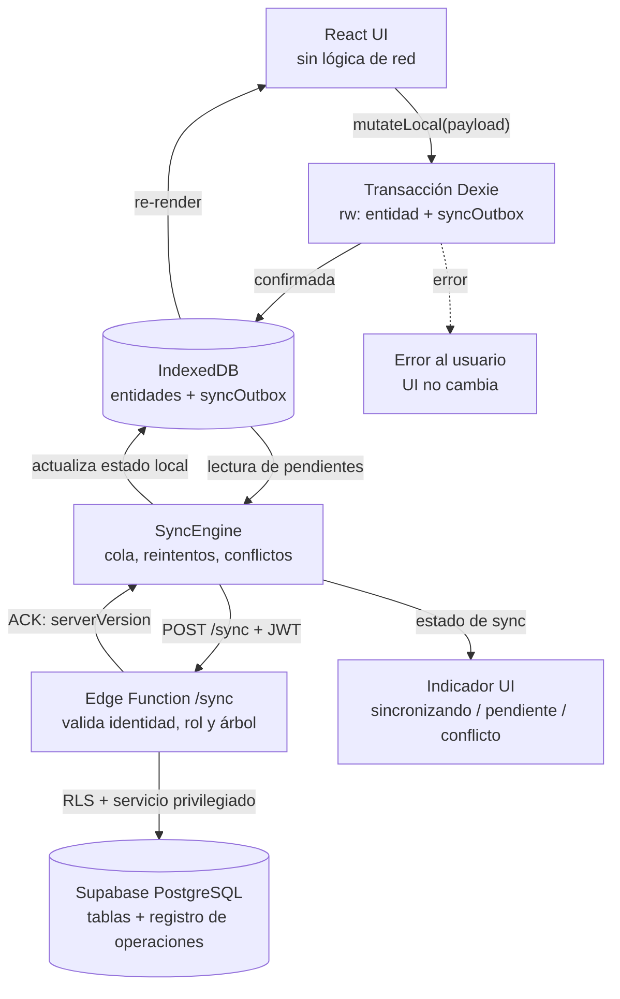

# SYNC-ARCHITECTURE.md

## Sincronización Offline-First

Este documento define el mecanismo por el cual Arbol Gen Pro guarda los cambios en el dispositivo, los persiste en una cola local y los propaga a Supabase cuando hay conectividad, resolviendo conflictos de forma explícita y sin sobrescribir silenciosamente el trabajo de otro usuario.

**Estado del documento**: arquitectura de diseño. Ninguna pieza descrita aquí está implementada todavía en el código del repositorio.

**Documentos relacionados**: `DATA-MODEL.md` (entidades y esquema), `ARCHITECTURE.md` (capas), `REQUIREMENTS.md` (RF-10, RF-11, RF-12, RF-13), `AI-CONTEXT.md` (reglas obligatorias).

---

## 1. Objetivos y Principios

### Objetivos

1. Permitir crear, editar y eliminar personas, relaciones, eventos y fotografías sin conexión.
2. Garantizar que ningún cambio del usuario se pierda por un cierre inesperado, un corte de red o un fallo del servidor.
3. Propagar los cambios al servidor de forma idempotente, reintentable y auditable.
4. Detectar ediciones concurrentes y obligar a una resolución explícita cuando el mismo registro fue modificado por dos personas.
5. Mantener el coste de infraestructura acotado (una tabla de operaciones, sin servicios adicionales ni procesos de servidor).

### Principios

| # | Principio | Consecuencia práctica |
|---|-----------|------------------------|
| P1 | **El dispositivo es la fuente de verdad de la sesión** | Toda mutación pasa primero por IndexedDB; la UI nunca espera a la red. |
| P2 | **Persistencia antes de efecto visual** | El cambio se confirma en IndexedDB y *después* se actualiza la UI. Si la escritura local falla, la UI no cambia. |
| P3 | **La sincronización es un proceso, no un evento de UI** | El motor no depende de React; se activa por conectividad, arranque, foco recuperado y acción manual. |
| P4 | **Toda operación es idempotente** | Reintentar la misma operación nunca duplica datos ni aplica dos veces una mutación. |
| P5 | **El servidor es la autoridad de versión** | El control de concurrencia se decide contra la versión en PostgreSQL, nunca contra un contador local. |
| P6 | **Nunca se sobrescribe trabajo ajeno en silencio** | Un conflicto bloquea la operación y exige una decisión del usuario. |
| P7 | **Nada se borra sin confirmación del servidor** | Una eliminación local permanece pendiente hasta que el servidor la confirma. |
| P8 | **Background Sync es una optimización, no un requisito** | La sincronización funciona sin Background Sync. |
| P9 | **Sin credenciales de R2 ni de Supabase en el navegador** | El cliente pide autorización de acceso a un servidor de confianza. |
| P10 | **El servidor valida todo** | Identidad, rol, árbol afectado y versión se comprueban en el servidor; el cliente no es una fuente de autoridad. |

> Nota sobre el modelo de UI: la aplicación muestra de inmediato el cambio local (optimistic UI) pero **después** de que la escritura en IndexedDB haya confirmado. No es un "optimistic UI" que aplica y luego revierte: si IndexedDB falla, el usuario ve un error y la interfaz no refleja el cambio.

---

## 2. Separación de versiones e identidad de las operaciones

Cuatro conceptos distintos conviven en el sistema. Confundirlos es la causa más común de errores de sincronización, por lo que se fijan aquí sus nombres, su dueño y quién los modifica.

| Concepto | Dónde vive | Quién lo modifica | Qué representa |
|---|---|---|---|
| `serverVersion` | Entidad local (tabla de entidades) | **Solo el servidor** la incrementa; el cliente la **recibe** en el ACK | Versión autoritativa del registro en PostgreSQL. Es el número que se compara en el control de concurrencia. |
| `baseServerVersion` | Operación en `syncOutbox` | El cliente, al encolar la operación | Copia del `serverVersion` que el cliente creía vigente cuando realizó la modificación. Es la **base de la comparación** contra el servidor. |
| `localRevision` | Entidad local | El cliente, en cada escritura local | Contador monótono **local** que distingue escrituras sucesivas sobre la misma entidad dentro de este dispositivo. Nunca se usa como criterio de conflicto. |
| `operationId` | Operación en `syncOutbox` | El cliente, al encolar la operación | Identificador **global y único** de la operación. Es la clave de idempotencia ante reintentos y duplicados. |

### 2.1 Regla de oro

> El cliente **nunca** incrementa `serverVersion`. Solo lo actualiza cuando el servidor confirma una operación (`applied` o `alreadyProcessed`).

Un `serverVersion` que el cliente incrementa por su cuenta rompe el control de concurrencia: dos dispositivos con el mismo valor de versión pasarían la comprobación de versión y el último en escribir pisaría al primero.

`localRevision` sí lo incrementa el cliente, y cumple una función distinta: permite saber si la versión local es más reciente que la que se usó como `baseServerVersion` de una operación todavía encolada, y detectar escrituras locales encadenadas sobre la misma entidad.

### 2.2 Cómo se obtiene la versión base de cada tipo de operación

| Tipo de operación | `baseServerVersion` | Justificación |
|---|---|---|
| `create` | `0` | La entidad no existe todavía en el servidor. El `0` es un centinela que significa "no hay versión previa". El servidor asigna `serverVersion = 1` al crear. |
| `update` | `serverVersion` conocido por el cliente al encolar | Es la versión sobre la que se hizo el cambio. Si el servidor tiene otra, hay conflicto. |
| `delete` | `serverVersion` conocido por el cliente al encolar | Un borrado también debe fallar si alguien modificó la entidad después, para no borrar trabajo ajeno en silencio. |

Cuando el cliente no conoce el `serverVersion` (por ejemplo, la entidad fue creada en este mismo dispositivo y aún no se ha confirmado), la operación se encola con `baseServerVersion = 0` y el servidor la trata como `create`. Esto evita enviar operaciones `update` sobre entidades que el servidor todavía no conoce.

### 2.3 Identidad de la operación

En el MVP, `operationId` es **la clave primaria** de `syncOutbox`. No se mantiene un `id` adicional: dos identificadores para la misma operación obligan a decidir cuál es la clave y complica la deduplicación en el servidor sin aportar capacidad alguna.

El `operationId` se genera en el cliente al encolar la operación y **nunca se reutiliza**. Es un UUID v7, por lo que:

- **No depende de un reloj local para garantizar unicidad.** La parte aleatoria de 74 bits del UUID v7 es la que garantiza la unicidad; el timestamp solo aporta ordenación lexicográfica aproximada. Dos dispositivos con relojes desincronizados no pueden colisionar.
- Sí es **aproximadamente** monotónico en el tiempo, lo que permite ordenar operaciones del mismo dispositivo de forma estable.

El servidor registra el `operationId` procesado junto a su resultado. Si recibe de nuevo la misma operación, devuelve el resultado anterior en lugar de volver a aplicarla (§10).

---

## 3. Decisión: control optimista frente a vector clocks

### 3.1 Evaluación

Los vector clocks resuelven un problema concreto: **determinar el orden causal entre operaciones que viajan por dispositivos distintos sin un coordinador**, cuando dos dispositivos pueden editar el mismo registro en paralelo y ambos tienen réplicas completas.

Para ese problema, el coste es alto:

- Cada entidad debe storing un mapa `{deviceId: counter}` y cada operación debe transportarlo.
- El servidor debe mantener y comparar vectores, no un entero.
- La resolución de "siguiente estado" deja de ser un contador y pasa a ser una comparación de relaciones de causalidad, con la lógica de dominancia y de "concurrentes" que implica.
- La deduplicación por `operationId` deja de ser suficiente como mecanismo de idempotencia, porque dos operaciones concurrentes legítimas no se pueden colapsar solo por ID.
- Multiplica el tamaño de la fila en Postgres y de la operación en la cola local.

### 3.2 Veredicto

**Los vector clocks no son necesarios para el MVP y no se implementarán.** Se adopta control optimista de concurrencia con versiones verificadas por el servidor.

Justificación aplicada a este producto:

1. El modelo de datos es **por árbol**, y cada árbol tiene un conjunto acotado de colaboradores (familiares), no una red abierta de miles de editores simultáneos.
2. El caso de uso dominante es **edición local por un dispositivo a la vez por persona**, con conflictos esporádicos entre familiares que editan el mismo registro en momentos distintos.
3. En ese contexto, un entero monotónico de versión por fila (`serverVersion`, incrementado por el servidor) detecta el conflicto con la misma eficacia que un vector clock, y su resolución es trivial de explicar al usuario ("alguien más editó este registro mientras tú no tenías conexión").
4. El vector clock solo aporta valor cuando **varias réplicas completas se modifican concurrentemente y ambas siguen vivas**, algo que en el MVP no ocurre: el servidor es el punto de convergencia y reconcilia cada operación en el momento de recibirla.

### 3.3 Cuándo reconsiderarlo

El vector clock debe reevaluarse si se cumple **cualquiera** de estas condiciones:

- Un árbol puede tener ediciones concurrentes frecuentes sobre el mismo registro (>1 conflicto real por semana en producción).
- Se introduce un modo de trabajo "offline largo" (días o semanas sin conectar) con varias personas editando las mismas personas.
- Se soporta ramificación de árboles (`branchId`) con divergencia real, no solo vista de sub-árbol.
- Se añade un modo "editar sin conexión en dispositivos compartidos" con más de un escritor por persona.

En ese escenario, la migración natural es **añadir `vectorClock` a la operación y a la entidad** (columna `jsonb`), conservando `baseServerVersion` para las operaciones ya en vuelo. Esa migración está prevista como evolución del esquema, no como requisito del MVP.

### 3.4 Consecuencias en la documentación

`ARCHITECTURE.md` y `DATA-MODEL.md` mencionan los vector clocks como principio activo (`DomainEvent.vectorClock` y una entrada de migración prevista). Se registra la contradicción en el informe de auditoría; la alineación de esos documentos corresponde a una revisión posterior y **no** se ha aplicado aquí para no modificar archivos ajenos a este documento.

---

## 4. Responsabilidades de los componentes

### 4.1 SyncEngine (Singleton)

| Responsabilidad | Descripción |
|---|---|
| **Detectar cambios locales** | Recibe las mutaciones que las capas de negocio registran tras una escritura confirmada en Dexie. No sondea la base de datos: el emisor de la mutación notifica el encolado. |
| **Encolar operación** | Crea el registro en `syncOutbox` dentro de la misma transacción Dexie que escribe la entidad (§7). |
| **Procesar lotes** | Ejecuta `processBatch()` al detectar conectividad, al recuperar el foco, al arrancar y cuando el usuario pulsa "Sincronizar ahora". |
| **Reintentos** | Controla `retryCount` y aplica backoff exponencial con tope. **Nunca descarta una operación**: al agotar los intentos automáticos pasa a `failed`, que conserva la operación y exige intervención explícita (§12). |
| **Resolución de conflictos** | Ante un `409`, marca la operación como `blocked`, guarda la información del conflicto y espera una decisión del usuario. |
| **Idempotencia** | Reenvía la misma operación con el mismo `operationId`; el servidor la deduplica (§10). |

### 4.2 Capas adyacentes (ajenas al motor)

- **React / UI**: nunca contiene lógica de red. Solo solicita mutaciones locales; la interfaz se actualiza tras la confirmación de la escritura en IndexedDB.
- **Capa de almacenamiento (Dexie)**: expone `db.entities.*` y `db.syncOutbox.*`; no sabe nada de HTTP ni de Supabase.
- **Capa PWA**: gestiona manifiesto, caché estático y `beforeinstallprompt`. No interviene en la cola de operaciones.
- **Capa de fotos / R2**: gestiona compresión local y subida de binarios. La subida de un binario es un flujo **distinto** del de las operaciones de datos (§13).

---

## 5. Esquema conceptual de `syncOutbox`

Tabla local de operaciones pendientes. Es la cola persistente del cliente.

### 5.1 Definición en Dexie

```typescript
// store: 'syncOutbox' — operationId es la clave primaria
syncOutbox: 'operationId, status, [entityType+entityId], createdAt'
```

- **Clave primaria**: `operationId` (UUID v7). No hay `id` adicional (§2.3).
- **Índice simple** sobre `status`: permite recuperar rápidamente todas las operaciones encoladas o fallidas.
- **Índice compuesto** `[entityType+entityId]`: sirve para localizar las operaciones que afectan a una entidad concreta. **No garantiza unicidad** (ese es el papel de `operationId`) y no se usa para deduplicar.
- **Índice** sobre `createdAt`: ordenación cronológica de la cola.

### 5.2 Campos

| Campo | Tipo | Descripción |
|---|---|---|
| `operationId` | `string` (UUID v7) | Clave primaria. Identificador global y único de la operación. |
| `entityType` | `'tree' \| 'person' \| 'relationship' \| 'photo' \| 'event' \| 'treeShare'` | Tipo de entidad afectada. |
| `entityId` | `string` | ID de la entidad afectada. |
| `operationType` | `'create' \| 'update' \| 'delete'` | Tipo de mutación. |
| `baseServerVersion` | `number` | Versión del servidor sobre la que se hizo el cambio (§2.2). |
| `payload` | `object \| null` | Datos de la entidad para `create`/`update`; `null` para `delete`. |
| `createdAt` | `number` | Marca de tiempo local (ms desde epoch) al encolar. **Solo informativa**: el orden real lo fija la cola y las dependencias, no el reloj. |
| `status` | `'pending' \| 'in_flight' \| 'confirmed' \| 'failed' \| 'blocked'` | Estado de la operación (§5.3). |
| `retryCount` | `number` | Número de intentos automáticos ya realizados. |
| `lastError` | `string \| null` | Último error registrado, **sin datos personales** (§12.4). |
| `dependsOn` | `string[]` | `operationId`s que deben confirmarse antes que esta (§14). |

### 5.3 Estados de la operación

| Estado | Significado | ¿Se reintenta automáticamente? |
|---|---|---|
| `pending` | Encolada, todavía no enviada. | Sí, cuando la cola se procesa. |
| `in_flight` | Enviada al servidor; se espera la respuesta. | No. Al reiniciar se vuelve a `pending` (§15). |
| `confirmed` | El servidor confirmó la operación (`applied` o `alreadyProcessed`). | No. Terminal. |
| `failed` | Error permanente o se agotaron los intentos automáticos. **Se conserva**. | No, hasta que el usuario (o una acción explícita) la reactive. |
| `blocked` | Conflicto de versión (`409`) pendiente de decisión del usuario. | No, hasta que el usuario resuelva. |

> Estos estados son **propios de la operación de sincronización** y no deben confundirse con el `syncStatus` de una entidad (`synced` / `pending` / `conflict` / `error`), que describe el estado de la última escritura local de esa entidad.

---

## 6. Arquitectura

### 6.1 Diagrama de componentes



### 6.2 Frontera cliente / servidor

| | Cliente (navegador) | Servidor (Supabase) |
|---|---|---|
| **Fuente de verdad de la sesión** | Sí (IndexedDB) | No |
| **Decide el orden de las operaciones** | Sí (cola y dependencias) | No |
| **Decide conflictos** | No | Sí (compara `baseServerVersion` con `serverVersion`) |
| **Asigna `serverVersion`** | No | Sí |
| **Valida permisos** | No (solo para reflejar la UI) | Sí (RLS + comprobación explícita en la Edge Function) |
| **Aplica la mutación** | No | Sí, de forma atómica |

---

## 7. Escritura local (offline-first)

### 7.1 Regla de transaccionalidad

**La escritura de la entidad y la creación de su operación en `syncOutbox` ocurren en la misma transacción Dexie.** Si la transacción falla, no se escribe ninguna de las dos cosas: nunca existe un cambio visible en la interfaz que no tenga una operación de sincronización asociada.

```typescript
// Pseudocódigo ilustrativo del patrón (no es implementación final)
await db.transaction('rw', db.persons, db.syncOutbox, async () => {
  await db.persons.put(person);                       // 1. entidad
  await db.syncOutbox.add(operation);                 // 2. operación de sync
});
```

Consecuencias:

- Si la transacción se confirma, la UI se actualiza (el cambio es un hecho persistido).
- Si la transacción se revierte, la UI **no** cambia y el usuario recibe un error. No hay estado intermedio "guardado en la interfaz pero no en disco".
- No existe el caso "cambio local sin operación": ambos se escriben o ninguno.

### 7.2 Secuencia de una escritura

1. El usuario realiza una acción (crear persona, editar relación, subir foto).
2. La capa de negocio prepara la entidad y la operación (con `operationId` y `baseServerVersion` calculados según §2.2).
3. Se ejecuta la transacción Dexie del §7.1.
4. **Solo si la transacción se confirma**, la UI se actualiza y la aplicación notifica al SyncEngine que hay trabajo pendiente.
5. Si la transacción falla, se muestra el error y no se modifica la UI.

### 7.3 Qué se incrementa al escribir

| Dato | Quién lo incrementa | Valor |
|---|---|---|
| `localRevision` | Cliente | +1 en cada escritura local de esa entidad. |
| `updatedAt` (local) | Cliente | Marca de tiempo local. Solo informativa. |
| `syncStatus` (entidad) | Cliente | Pasa a `pending`. |
| `serverVersion` | **Servidor** | **No se toca.** Se actualiza únicamente al recibir el ACK. |

---

## 8. Flujo de sincronización

### 8.1 Disparadores

El motor se ejecuta cuando se cumple **cualquiera** de estos:

- Detección de conectividad (`online` / `navigator.onLine`).
- Recuperación del foco de la ventana (`visibilitychange`, `focus`).
- Arranque de la aplicación.
- Acción manual del usuario ("Sincronizar ahora").
- Intervalo periódico mientras queden operaciones pendientes (30 s).

El intervalo es una **optimización**, no un requisito de corrección: aunque el navegador lo suspenda en segundo plano, los demás disparadores garantizan la sincronización.

> **Background Sync** (`ServiceWorkerRegistration.sync`) puede añadirse como mejora en navegadores que lo soporten, pero **el diseño no depende de él** (P8). Si se usa, sirve únicamente para *despertar* al motor; la lógica de reintentos vive en el cliente, no en el Service Worker.

### 8.2 Ciclo de procesamiento

```
1. Recuperar operaciones pendientes de syncOutbox (status = pending)
2. Calcular el orden respetando dependencias (dependsOn)          -> §14
3. Para cada operación, en orden:
   a. Marcar in_flight y registrar el intento
   b. Enviar al servidor
   c. Clasificar la respuesta                                        -> §12
   d. Aplicar la respuesta en IndexedDB
4. Repetir mientras queden operaciones y el lote no exceda el tamaño máximo
```

### 8.3 Resultado de cada respuesta

| Respuesta | Estado local resultante | `serverVersion` local |
|---|---|---|
| `200 applied` | `confirmed` | Se actualiza al valor devuelto. |
| `200 alreadyProcessed` | `confirmed` | Se actualiza al valor devuelto (o se conserva si el servidor no lo envía). |
| `409 conflict` | `blocked` + datos del conflicto | **No se cambia.** El conflicto requiere decisión. |
| `401` | Se intenta renovar la sesión y reintentar una vez | No se cambia. |
| `403` | `failed` (permisos insuficientes) | No se cambia. |
| `429` | `pending` con `retryCount` incrementado y espera indicada por el servidor | No se cambia. |
| `4xx` permanente (400, 413, 422) | `failed` | No se cambia. |
| `5xx` / error de red | `pending` con `retryCount` incrementado | No se cambia. |

### 8.4 Recuperación si se pierde la respuesta

Este es el caso más delicado: el servidor **aplica** la operación, pero la respuesta se pierde (red caída, proceso cerrado).

1. El cliente no recibe ACK y la operación queda en `in_flight`.
2. El backoff hace que vuelva a intentarse con el **mismo `operationId`**.
3. El servidor reconoce el `operationId` como ya procesado y responde `alreadyProcessed` con el resultado guardado (§10).
4. El cliente marca la operación como `confirmed` y actualiza `serverVersion`.

Por eso la clave de idempotencia debe persistir **en la operación**, no en memoria del proceso: es lo que permite que un reintento posterior a un reinicio no duplique la mutación.

---

## 9. Protocolo cliente ↔ servidor

### 9.1 Petición

```
POST /sync
Authorization: Bearer <JWT del usuario>
Content-Type: application/json
Idempotency-Key: <operationId>

{
  "operationId": "0191...",              // UUID v7, clave de idempotencia
  "entityType": "person",
  "entityId": "pers_123",
  "operationType": "update",
  "baseServerVersion": 5,                // versión que el cliente creyó vigente
  "payload": { ... },                     // datos de la entidad (null en delete)
  "createdAt": 1747920000000             // informativo, no se usa para ordenar
}
```

El `operationId` viaja en el cuerpo **y** en la cabecera `Idempotency-Key` para que el servidor pueda deduplicar sin depender del formato del cuerpo.

### 9.2 Respuestas

```
200 applied:              { "operationId": "...", "status": "applied", "serverVersion": 6 }
200 alreadyProcessed:     { "operationId": "...", "status": "alreadyProcessed", "serverVersion": 6 }
409 conflict:             { "operationId": "...", "status": "conflict",
                            "serverVersion": 7, "conflictKind": "version" }
400 bad_request:          { "operationId": "...", "status": "failed", "errorCode": "invalid_payload" }
401 unauthorized:         { "operationId": "...", "status": "failed", "errorCode": "session_expired" }
403 forbidden:            { "operationId": "...", "status": "failed", "errorCode": "forbidden" }
409 deleted_remotely:     { "operationId": "...", "status": "conflict",
                            "conflictKind": "deleted_remotely" }
429 too_many_requests:    { "operationId": "...", "status": "failed", "errorCode": "rate_limited",
                            "retryAfterSeconds": 30 }
5xx server_error:         { "operationId": "...", "status": "failed", "errorCode": "server_error" }
```

### 9.3 Contrato del lado servidor

El endpoint `/sync` es una **Edge Function** que, en este orden:

1. **Verifica la identidad**: valida el JWT y extrae el `userId`. Nunca usa el `userId` que envíe el cliente.
2. **Verifica la autorización**: comprueba que el usuario tiene membresía activa en el árbol afectado y que su rol permite la operación. El `treeId` lo **deriva de la entidad** en el servidor, no lo acepta desde el cliente.
3. **Verifica la idempotencia**: busca el `operationId` en el registro de operaciones procesadas. Si existe, devuelve el resultado guardado sin volver a aplicar la mutación.
4. **Verifica la versión base**: para `update` y `delete`, compara `baseServerVersion` con la `serverVersion` actual de la fila.
5. **Aplica la mutación de forma atómica**: la escritura y el registro de la operación se confirman en la **misma transacción** de PostgreSQL.
6. **Registra el resultado**: guarda `operationId` → `{status, serverVersion, entityId}`.

> Los puntos 3, 4 y 5 deben ser atómicos entre sí. Si el registro de la operación se escribiera en una transacción separada de la mutación, un fallo intermedio podría dejar una mutación aplicada sin su registro de idempotencia, y un reintento la duplicaría.

---

## 10. Idempotencia y deduplicación

### 10.1 Registro de operaciones procesadas

El servidor mantiene una tabla de operaciones procesadas:

| Campo | Descripción |
|---|---|
| `operation_id` | **Clave primaria** (UUID). Es lo que garantiza la deduplicación. |
| `user_id` | Usuario que originó la operación. Evita que un `operationId` de otro usuario se reutilice. |
| `entity_type` / `entity_id` | Entidad afectada. |
| `operation_type` | `create` / `update` / `delete`. |
| `result_status` | `applied` (o `conflict` / `rejected`). |
| `result_server_version` | `serverVersion` resultante. Se devuelve en las respuestas posteriores. |
| `processed_at` | Marca de tiempo del servidor. |

### 10.2 Cómo se comporta el servidor

| Situación | Comportamiento |
|---|---|
| `operationId` nuevo | Se aplica la mutación y se registra el resultado. |
| `operationId` ya procesado | Se devuelve el **resultado guardado** (`alreadyProcessed`) sin tocar datos. |
| `operationId` en proceso (petición simultánea) | El registro se inserta **antes** de aplicar la mutación dentro de la misma transacción; la segunda petición espera el bloqueo de fila o recibe el resultado ya confirmado. |

La deduplicación funciona ante peticiones **repetidas** (mismo `operationId`, tras un timeout o un reinicio) y ante peticiones **simultáneas** (dos reintentos en paralelo del mismo `operationId`), porque la garantía la aporta la restricción de clave primaria en PostgreSQL, no la lógica de aplicación.

### 10.3 Reglas del cliente

- El `operationId` se genera **una sola vez**, al encolar la operación, y se conserva en todas los reintentos.
- El cliente solo marca una operación como `confirmed` tras recibir `applied` o `alreadyProcessed`.
- Una operación **nunca** se marca `confirmed` por optimizar el estado local ni por suposición: sin ACK del servidor, sigue pendiente.

---

## 11. Control de concurrencia y resolución de conflictos

### 11.1 Detección

El cliente envía `baseServerVersion` (§9.1). El servidor lo compara con la `serverVersion` actual de la fila:

| Comparación | Significado | Respuesta |
|---|---|---|
| `baseServerVersion == serverVersion` | Nadie ha tocado la entidad desde que el cliente la leyó. | Se aplica la operación. |
| `baseServerVersion < serverVersion` | La entidad **ya fue modificada** por otra persona (o por este dispositivo en un paso previo todavía sin confirmar). | `409` con `conflictKind: "version"`. |
| `baseServerVersion > serverVersion` | El cliente envía una versión **imposible** (más nueva que la del servidor): indica un cliente desincronizado o manipulado. | `409` con `conflictKind: "client_stale"`. El servidor no aplica nada. |

La comparación la hace **siempre el servidor**, sobre el valor almacenado en PostgreSQL. El cliente no decide si hay conflicto.

### 11.2 Resolución: siempre manual

El servidor devuelve en el `409` la información necesaria para que el usuario decida, **sin revelar datos a los que el solicitante no tenga acceso** (§17):

- `serverVersion` actual.
- Los campos del servidor que han cambiado respecto a la base (o el snapshot completo, si el solicitante tiene permiso de lectura sobre esa entidad).

El cliente marca la operación como `blocked` y ofrece al usuario estas opciones:

| Opción | Efecto |
|---|---|
| **Reintentar sobre la versión actual** | Se crea una **nueva** operación con `baseServerVersion = serverVersion` (la que informa el servidor) y el mismo contenido local. |
| **Adoptar la versión del servidor** | Se descarta el cambio local de esa operación y la entidad local se actualiza con los datos del servidor. |
| **Fusionar manualmente** | El usuario edita y guarda el resultado, generando una operación nueva. |
| **Descartar el cambio local** | La operación pasa a `confirmed` sin aplicarse. El cambio del usuario se pierde de forma **explícita y visible**, nunca en silencio. |

> **Nunca hay auto-merge** de personas por similitud de nombre o fotografía (`AI-CONTEXT.md` §1.5). Tampoco hay auto-merge *de campos* en el MVP: cualquier conflicto exige una decisión explícita.

### 11.3 Advertencia sobre "última escritura gana"

Una estrategia *last-write-wins* (el servidor acepta siempre la escritura más reciente y descarta la anterior) **no se usa en este diseño**, porque:

- **Destruye trabajo sin avisar.** Si un familiar edita la fecha de nacimiento de un ancestro y otro edita la biografía sin conexión, la biografía se pierde sin que nadie lo sepa.
- **No es determinista.** El resultado depende del orden de llegada, que con dispositivos offline es arbitrario.
- **Choca con los principios del proyecto.** `AI-CONTEXT.md` §1.4 prohíbe confiar en la última escritura sin vector de versión, y el principio P6 de este documento prohíbe sobrescribir trabajo ajeno en silencio.

La alternativa adoptada (control optimista + resolución manual) es más trabajo de implementación, pero es la que el producto necesita: en un árbol genealógico, un dato familiar perdido de forma silenciosa es un daño real para el usuario.

---

## 12. Reintentos y clasificación de errores

### 12.1 Clasificación de errores

| Situación | HTTP | Clase | Tratamiento |
|---|---|---|---|
| **Pérdida de conexión** | — (error de red) | Temporal | Vuelve a `pending`, `retryCount++`, se aplica backoff. La operación queda intacta. |
| **Timeout / red intermitente** | — | Temporal | Igual que el anterior. |
| **Error del servidor** | `500`, `502`, `503`, `504` | Temporal | Igual que el anterior. |
| **Límite de peticiones** | `429` | Temporal | Vuelve a `pending`, respeta el `Retry-After` si el servidor lo envía; si no, backoff estándar. |
| **Payload inválido** | `400`, `422` | Permanente | `failed`. **No se reintenta**: reenviar el mismo payload volverá a fallar. Se informa al usuario. |
| **Sesión expirada** | `401` | Recuperable | Se intenta renovar el token **una vez** (§12.2). Si la renovación falla, la operación pasa a `failed` con `errorCode: "session_expired"` y el usuario debe iniciar sesión de nuevo. |
| **Sin permisos** | `403` | Permanente | `failed` con `errorCode: "forbidden"`. Puede ocurrir si se revocó el acceso al árbol o el rol no permite la operación. No se reintenta automáticamente. |
| **Conflicto de versión** | `409` | Requiere decisión | `blocked`. Espera al usuario (§11.2). |
| **Demasiado grande** | `413` | Permanente | `failed`. El usuario debe elegir un archivo menor. |

### 12.2 Tratamiento del `401`

1. El cliente detecta el `401`.
2. Intenta **una** renovación de sesión (refresh token).
3. Si la renovación tiene éxito, reenvía la **misma** operación con el **mismo** `operationId` (la idempotencia hace que el reintento sea seguro).
4. Si la renovación falla, la operación pasa a `failed` con `errorCode: "session_expired"`. **No se pierde**: al iniciar sesión de nuevo, el usuario puede reactivarla desde la bandeja de pendientes.

### 12.3 Backoff progresivo

```text
delay = min(BASE_DELAY * 2^retryCount, MAX_DELAY) + random(0, JITTER)
```

| Parámetro | Valor de referencia | Nota |
|---|---|---|
| `BASE_DELAY` | 2 s | Valor inicial. |
| `MAX_DELAY` | 5 min | Tope del crecimiento exponencial. |
| `JITTER` | 0 – 1 s | Evita que varios dispositivos reintenten a la vez. |
| `MAX_ATTEMPTS` | 5 | Intentos **automáticos**. Coincide con RF-11.5. |

El jitter es importante: sin él, N dispositivos que fallan simultáneamente reintentan simultáneamente y reproducen la caída que provocó el fallo.

### 12.4 Límite de intentos: la operación se conserva

Cuando `retryCount` alcanza `MAX_ATTEMPTS`, la operación pasa a `failed` y **se conserva íntegra** en `syncOutbox`:

- **No se elimina.** No se descarta información, ni el payload, ni el `operationId`.
- No se reintenta automáticamente (un `400` no se arregla reintentando).
- El usuario ve un aviso con el número de operaciones fallidas y puede actuar:
  - **Reintentar** todas: `retryCount = 0`, estado `pending`.
  - **Reintentar una** concreta.
  - **Descartar** una concreta, lo que la marca como `confirmed` **sin aplicarse**, de forma explícita y visible.
- `lastError` guarda **un código de error y un mensaje técnico**, nunca el contenido del payload ni datos personales (nombres, correos, ubicaciones).

### 12.5 Trazabilidad sin datos personales

Los registros de error y de auditoría deben poder diagnosticar un fallo sin exponer información de las familias:

| Se registra | No se registra |
|---|---|
| `operationId`, `entityType`, `entityId` | El contenido del `payload` |
| Código de error HTTP y `errorCode` | Nombres, apellidos, correos |
| `retryCount`, duración, marca de tiempo | Ubicaciones,|biografías, notas |
| `userId` (interno) | El JWT ni el `service_role` |

---

## 13. Eliminaciones y tombstone

### 13.1 Por qué no hay borrado físico

Un borrado físico en el servidor rompería la sincronización offline-first: un dispositivo que estuvo desconectado durante meses volvería a **recrear** la entidad con su siguiente operación, resucitando datos que el usuario había borrado.

Por eso toda eliminación es **lógica**: la fila permanece en el servidor marcada como eliminada.

### 13.2 Representación

Cada entidad eliminable lleva un campo de tombstone:

| Campo | Tipo | Significado |
|---|---|---|
| `deletedAt` | `number \| null` | Marca de tiempo del servidor en la que se marcó como eliminada. `null` = la entidad existe. |
| `serverVersion` | `number` | La versión se incrementa también al eliminar, igual que en una actualización. |

En el cliente, la entidad se marca localmente con `syncStatus = 'pending'` y la operación `delete` permanece en la cola hasta que el servidor confirme.

> El nombre exacto del campo y su tipo deben alinearse con `DATA-MODEL.md` (§20.2, D4). Esta es una decisión pendiente de unificación entre ambos documentos.

### 13.3 Comportamiento del servidor ante un `delete`

| Situación | Respuesta |
|---|---|
| La entidad existe y `baseServerVersion` coincide | Se marca el tombstone, `serverVersion++`, se responde `applied` con la nueva versión. |
| La entidad existe pero `baseServerVersion` **no** coincide | `409` con `conflictKind: "version"`. **No se borra**: el trabajo ajeno no se pierde en silencio. |
| La entidad **ya está eliminada** (tombstone existente) | Se responde `applied` (operación idempotente): el resultado buscado ya se cumple. No es un conflicto. |
| La entidad **no existe** en el servidor | Se responde `applied` con un código `already_deleted`. El borrado es idempotente. |

### 13.4 Escenarios críticos

| Escenario | Resultado |
|---|---|
| **Una persona se elimina sin conexión.** | La operación `delete` queda `pending` con su `baseServerVersion`. La entidad sigue visible localmente hasta la confirmación. |
| **Otro dispositivo modifica esa persona mientras el primero está desconectado.** | Cuando el primero sincroniza, el servidor compara las versiones: si difieren, devuelve `409`. El usuario decide entre **reintentar el borrado** (forzar) o **conservar la modificación remota**. **No se borra automáticamente.** |
| **Una eliminación entra en conflicto con una modificación.** | Es el caso anterior. La resolución es manual (opciones de §11.2, con la variante "reintentar el borrado sobre la versión actual"). |
| **Existen relaciones, eventos o fotografías asociados.** | El borrado de una persona **no** debe dejar referencias colgantes ni borrar en cascada de forma silenciosa. La política de cascada (borrar en cascada, bloquear el borrado o desvincular) es una **decisión funcional pendiente** (§20.3, F1). Lo que sí es fijo: cualquier cascada genera sus propias operaciones `delete`, cada una con su `operationId`, y todas se confirman de forma independiente. |
| **Un dispositivo antiguo intenta sincronizar datos de una persona eliminada.** | El servidor ve que la entidad tiene `deletedAt` y la versión no coincide: responde `409` con `conflictKind: "deleted_remotely"`. El cliente **no recrea la persona**: la marca como eliminada localmente y avisa al usuario. |
| **Un dispositivo antiguo intenta *recrear* una persona eliminada.** | El `create` con `baseServerVersion = 0` sobre una fila con tombstone devuelve `409` con `conflictKind: "deleted_remotely"`. El usuario debe decidir explícitamente si la restaura. |

### 13.5 Limpieza de tombstone

Los tombstones se conservan en el servidor durante un periodo de retención (valor a decidir, §20.3, F2) y luego se eliminan físicamente. Mientras un cliente antiguo pueda intentar sincronizar, el tombstone debe permanecer: es la única garantía de que no se resucite un dato borrado.

---

## 14. Dependencias entre operaciones

### 14.1 Dependencias reales

Hay mutaciones que **no pueden aplicarse** hasta que otras se han confirmado:

| Operación dependiente | Depende de | Motivo |
|---|---|---|
| Crear una relación progenitor/hijo | Crear la persona padre y la persona hija | Las claves foráneas deben existir. |
| Crear una pareja | Crear ambas personas | Ídem. |
| Crear un evento de una persona | Crear la persona | Ídem. |
| Adjuntar una foto a una persona | Crear la persona | Ídem. |
| Eliminar una persona | Las operaciones que la modifican | Para no borrar una versión que aún no se ha sincronizado. |

### 14.2 Cómo se modela

El campo `dependsOn: string[]` de la operación (§5.2) contiene los `operationId` de las operaciones que deben estar `confirmed` antes de enviarse. Es una referencia **local**, no un dato que el servidor necesite recibir: el servidor valida sus propias claves foráneas en la base de datos.

### 14.3 Algoritmo de ordenación

1. Se leen todas las operaciones `pending`.
2. Se construye el grafo de dependencias a partir de `dependsOn`.
3. Se calcula un **orden topológico**: una operación es enviable cuando todas sus dependencias están `confirmed`.
4. Las operaciones cuyas dependencias están `failed` o `blocked` **no se envían** y quedan esperando; se informa al usuario de que están bloqueadas por otra operación.

```text
create(persona A)  ->  create(persona B)  ->  create(relationship A-B)
        (ok)                (ok)                    (enviable)
```

Una dependencia circular es imposible en la práctica (una operación no puede depender de una posterior), pero el motor debe detectar el ciclo y marcar el grupo como `blocked` en lugar de bloquear el procesamiento del resto de la cola.

---

## 15. Recuperación tras cierre o reinicio

### 15.1 Principio

`IndexedDB` es persistente y sobrevive al cierre de la aplicación, a un reinicio del dispositivo y a un crash del navegador. La cola `syncOutbox` está en él, por lo que **ninguna operación confirmada localmente se pierde** por un cierre inesperado.

### 15.2 Qué ocurre en cada punto de fallo

| Momento del fallo | Estado en disco | Consecuencia |
|---|---|---|
| **Antes** de la transacción Dexie | Nada escrito | El cambio no ocurrió. La UI no lo mostró. El usuario reintenta. |
| **Dentro** de la transacción Dexie | Transacción revertida | Ni entidad ni operación. Sin estado intermedio. |
| **Tras** la transacción, **antes** de enviar | Entidad escrita + operación `pending` | Al arrancar, la operación se envía normalmente. |
| **Mientras** la petición está en curso | Operación `in_flight` | Al arrancar, `in_flight` vuelve a `pending` y se reenvía con el mismo `operationId`. El servidor deduplica (§10). |
| **El servidor ya aplicó**, pero la respuesta se perdió | Servidor: aplicada. Cliente: `in_flight`. | El reenvío recibe `alreadyProcessed` y el cliente se sincroniza sin duplicar. |
| **Tras** aplicar la respuesta en IndexedDB | Operación `confirmed` | Nada pendiente. |

### 15.3 Rutina de arranque

Al iniciar la aplicación, el motor ejecuta, **en este orden**:

1. **Reparar operaciones huérfanas**: toda operación `in_flight` pasa a `pending` (puede que el servidor ya la aplicara; la idempotencia lo resuelve).
2. **Verificar coherencia**: si una entidad tiene `syncStatus = 'pending'` pero no existe ninguna operación que la reference, se marca `error` para que el usuario lo revise. Esto detecta escrituras manuales o datos corruptos.
3. **Reintentar operaciones fallidas** solo si el usuario lo pidió explícitamente (no automáticamente, §12.4).
4. **Procesar la cola** si hay conexión.

### 15.4 Datos corruptos

Si una operación no se puede deserializar (payload inválido, esquema incompatible tras una migración), se marca `failed` con `errorCode: "corrupt_payload"` y **no se elimina**. El usuario puede descartarla de forma explícita. Nunca se descarta en silencio.

---

## 16. Estados visibles para el usuario

RF-10.2 y RF-13 exigen que el usuario sepa en qué estado está la sincronización. El indicador global (en el encabezado) deriva de la cola:

| Estado visible | Condición | Significado para el usuario |
|---|---|---|
| `offline` | Sin conectividad detectada | "Tus cambios se guardan en el dispositivo y se enviarán al recuperar conexión." |
| `synced` | Sin operaciones `pending`, `in_flight`, `failed` ni `blocked` | "Todo está sincronizado." |
| `pending` | Hay operaciones `pending` o `in_flight` | "N cambios esperando enviar." |
| `syncing` | El motor está procesando la cola | "Sincronizando…" |
| `conflict` | Hay operaciones `blocked` | "N cambios en conflicto requieren tu decisión." |
| `error` | Hay operaciones `failed` | "N cambios no se han podido enviar." |

El indicador es un **derivado** del estado de la cola, no un campo independiente que pueda desincronizarse. Se implementa como una consulta reactiva a `syncOutbox` (por ejemplo, con `useLiveQuery` de Dexie), de modo que la UI refleja siempre la cola real.

---

## 17. Seguridad y permisos

### 17.1 Qué valida el servidor

Toda operación pasa por la Edge Function, que valida **en este orden**:

1. **Identidad**: el JWT es válido y no ha expirado. El `userId` se extrae del token, **nunca** del cuerpo de la petición.
2. **Autorización sobre el árbol**: el usuario tiene una membresía activa en el árbol al que pertenece la entidad. El `treeId` se **deriva de la entidad en el servidor**, no se toma del cliente.
3. **Rol**: `owner` y `editor` pueden escribir; `viewer` no puede. Las operaciones `delete` pueden estar restringidas al `owner` (decisión funcional pendiente, §20.3, F5).
4. **Idempotencia**: `operationId` no procesado (o ya procesado → se devuelve el resultado guardado).
5. **Versión base**: `baseServerVersion` coincide con la `serverVersion` almacenada.
6. **Validez del payload**: esquema y tipos verificados en el servidor (SEC-04 de `AI-CONTEXT.md`).

### 17.2 RLS y credenciales privilegiadas

| Aspecto | Enfoque |
|---|---|
| **RLS en PostgreSQL** | Las políticas restringen el acceso directo por rol de Supabase. Es una **capa de defensa**, no la única: la Edge Function comprueba los permisos explícitamente. |
| **Rol de servicio (`service_role`)** | Lo usa **solo** el servidor. Nunca viaja al navegador ni aparece en variables `VITE_*`. |
| **Contexto de la petición** | La Edge Function fija el usuario autenticado en la sesión de base de datos (`request.jwt.claims`) para que las políticas RLS se apliquen también a las operaciones que ejecuta. |
| **Bypass de RLS** | Si la Edge Function escribe con rol de servicio, las políticas RLS **no** se aplican: por eso la comprobación explícita del punto 2 es obligatoria y no opcional. |

### 17.3 Fotografías y R2

- El bucket de R2 es **privado**. El navegador **nunca** recibe credenciales de R2 (SEC-02).
- El navegador pide una **URL firmada de corta duración** a la Edge Function, que la genera tras validar identidad y autorización sobre el árbol.
- R2 admite URLs firmadas S3 (SigV4) con expiración entre 1 segundo y 7 días; para este producto se usa una expiración corta (RF-03.3 indica 15 minutos).
- Una URL firmada es un **token de portador**: quien la tenga puede usarla hasta que expire. Por eso se solicitan de forma explícita, con caducidad corta, y nunca se incrusta en logs.
- La Edge Function **valida el tipo MIME y el tamaño** del archivo antes de firmar la subida.

### 17.4 Validación de archivos

| Control | Regla |
|---|---|
| Tipo MIME | Solo imágenes (`image/jpeg`, `image/png`, `image/webp`, `image/heic`). El contenido se valida **en el servidor**, no por la extensión. |
| Tamaño máximo | Límite por archivo, acordado y verificado antes del despliegue (§20.3, F4). |
| Clave del objeto en R2 | Generada en el servidor a partir de IDs, **nunca** del nombre original del archivo: evita colisiones y fugas de rutas. |
| Metadatos EXIF | Se conservan en el original y se eliminan de las versiones web (RF-06.7). |

### 17.5 No filtrar datos en las respuestas de conflicto

La respuesta `409` incluye datos del servidor **solo si el solicitante tiene permiso de lectura sobre esa entidad**. Si el acceso fue revocado entre la operación y la respuesta, el servidor devuelve el conflicto **sin el snapshot**, indicando únicamente que existe un conflicto y que el usuario ya no tiene permiso sobre ese árbol.

### 17.6 Ausencia de secretos en el frontend

| Variable | ¿Permitida en `VITE_*`? |
|---|---|
| URL y clave pública (`anon`) de Supabase | Sí |
| `SUPABASE_SERVICE_ROLE_KEY` | **No** |
| Claves de API de R2 (Access Key / Secret Key) | **No** |
| Secreto JWT de Supabase | **No** |
| Credenciales de la cuenta de Cloudflare | **No** |

---

## 18. Estrategia de pruebas

### 18.1 Pruebas unitarias (motor de sincronización)

| Caso | Qué verifica |
|---|---|
| Cálculo de `baseServerVersion` | `create` → `0`; `update`/`delete` → `serverVersion` conocido (§2.2). |
| Cálculo del backoff | Exponencial, respeta el tope y añade jitter (§12.3). |
| Clasificación de respuestas | Cada código HTTP lleva al estado correcto (§12.1). |
| No se pierde una operación | Ningún camino de código elimina una operación de `syncOutbox`. |
| Orden topológico | Las dependencias se respetan; los ciclos se detectan (§14.3). |
| Transiciones de estado | `pending` → `in_flight` → `confirmed`/`failed`/`blocked` son válidas y no se saltan. |

### 18.2 Pruebas de integración (IndexedDB)

| Caso | Qué verifica |
|---|---|
| Atomicidad | Si la escritura de la operación falla, la entidad **tampoco** se escribe (§7.1). |
| Persistencia | Una operación encolada sobrevive a la recreación del objeto `Dexie` (§15). |
| Índices | Las consultas por `status` y por `[entityType+entityId]` devuelven lo esperado. |

### 18.3 Pruebas de contrato (servidor)

| Caso | Qué verifica |
|---|---|
| Idempotencia | Dos peticiones con el mismo `operationId` producen **un solo** efecto (§10.2). |
| Peticiones simultáneas | Dos reintentos concurrentes del mismo `operationId` no duplican la mutación. |
| Control de concurrencia | Con `baseServerVersion` desfasado, el servidor devuelve `409` y **no** escribe. |
| Autorización | Un usuario sin membresía o con rol `viewer` no puede escribir. |
| No filtración | Un `409` para un solicitante sin permiso no incluye el snapshot del servidor (§17.5). |
| Eliminado remoto | Una operación sobre una entidad con tombstone devuelve `409 deleted_remotely` y no la recrea (§13.4). |

### 18.4 Pruebas end-to-end de los escenarios críticos

1. **Offline completo**: crear → editar → eliminar personas y relaciones sin red; al recuperar conexión, todo llega al servidor sin duplicados.
2. **Cierre inesperado**: encolar operaciones, cerrar la aplicación a mitad, reabrir y verificar que la cola se reanuda.
3. **Respuesta perdida**: aplicar la mutación en el servidor, cortar la respuesta, reintentar y verificar que el resultado es `alreadyProcessed`.
4. **Conflicto**: dos dispositivos editan la misma persona offline y ambos reconectan; verificar `409`, que ninguno pisa al otro y que la UI de resolución funciona.
5. **Eliminación remota**: el dispositivo A borra una persona y el dispositivo B (offline) la modifica; al reconectar, B no la resucita.

---

## 19. Limitaciones conocidas del MVP

| # | Limitación | Consecuencia |
|---|---|---|
| L1 | **Sin vector clocks** | Los conflictos se resuelven por versión de fila. Suficiente para el uso descrito en §3.2; se reevalúa con los criterios de §3.3. |
| L2 | **Sin auto-merge de campos** | Todo conflicto exige una decisión manual del usuario. Más fricción, cero pérdida silenciosa. |
| L3 | **Conflictos por entidad, no por campo** | No se puede fusionar automáticamente solo los campos que no colisionan. |
| L4 | **Sin sincronización en tiempo real** | No hay WebSocket ni push. La sincronización es por disparo y por intervalo. |
| L5 | **Sin resolución automática de conflictos** | El usuario debe intervenir; no hay "última escritura gana". |
| L6 | **Cola local sin límite de tamaño** | Un dispositivo con muchos fallos acumulados acumula operaciones. Requiere una política de purga (decisión pendiente, §20.3). |
| L7 | **Sin descarga automática de originales** | Los originales en R2 no se descargan solos; el usuario los abre bajo demanda (§19.1). |
| L8 | **Sin soporte multi-árbol simultáneo** | El MVP sincroniza un árbol activo a la vez. |
| L9 | **Relojes locales no fiables** | `createdAt` es informativo. Todo lo que depende de orden real usa `serverVersion` y las dependencias. |

### 19.1 Fotos: separación de los tres estados

Debe distinguirse con claridad:

| Estado | Qué es | Dónde vive |
|---|---|---|
| **Guardado** | El archivo existe en el dispositivo (original, optimizada o miniatura). | IndexedDB (`photoBlobs`). |
| **Subido** | El binario está en R2 y tiene clave (`r2Key`). | R2 (bucket privado). |
| **Registrado** | Los **metadatos** de la foto están sincronizados en PostgreSQL. | Tabla `photo` en Supabase. |

Reglas:

- El archivo local **no se elimina** hasta que los metadatos están registrados y confirmados en el servidor.
- Los archivos pendientes de subida **sobreviven** a la desconexión porque residen en IndexedDB.
- Los originales **no se descargan automáticamente** a otros dispositivos; se solicitan bajo demanda con una URL firmada.
- Si el dispositivo se queda sin espacio, la aplicación debe avisar **antes** de borrar y nunca borrar la única copia local de una foto aún no registrada.

---

## 20. Contraste con `DATA-MODEL.md`

Esta sección registra, de forma verificable, las coincidencias y discrepancias entre este documento y `DATA-MODEL.md`. **No se han modificado los demás documentos**: las discrepancias se listan aquí para su corrección posterior.

### 20.1 Coincidencias confirmadas

| Elemento | `DATA-MODEL.md` | `SYNC-ARCHITECTURE.md` | Estado |
|---|---|---|---|
| UUID v7 | `type UUID = string` ("timestamp + random") | §2.3 | Coincide |
| `syncStatus` de entidad | `'synced' \| 'pending' \| 'conflict' \| 'error'` | §16, §5.3 (nota de distinción) | Coincide |
| `syncOutbox` como store de Dexie | `syncOutbox: 'id, ...'` | §5.1 | **Discrepa** (D1) |
| Constraint de idempotencia | "SyncOutbox `id` (eventId) único" | §2.3, §5.1, §10 | **Discrepa** (D1) |
| Vector clocks | Declarados como principio activo | §3.2: no necesarios en el MVP | **Discrepa** (D2) |
| Versión de la entidad | `version: number`, "Incrementa en cada actualización local" | §2.1: solo el servidor la incrementa | **Discrepa** (D3) |

### 20.2 Discrepancias detectadas

| # | Discrepancia | Ubicación | Riesgo | Recomendación | Prioridad |
|---|---|---|---|---|---|
| **D1** | La clave primaria de `syncOutbox` es `id` en `DATA-MODEL.md` (store Dexie y constraint "SyncOutbox `id` (eventId) único"), mientras aquí es `operationId` sin `id` adicional. `DATA-MODEL.md` tampoco define `baseServerVersion`, `operationType`, `payload`, `lastError` ni `dependsOn`, y usa `operation`/`timestamp` en lugar de `operationType`/`createdAt`. | `DATA-MODEL.md`: store Dexie + tabla de constraints | **Crítico** | Renombrar la clave primaria a `operationId` y añadir los campos indicados. Eliminar `id`/`eventId` del modelo del outbox. | Crítica |
| **D2** | `DATA-MODEL.md` declara `vectorClock` en `SyncOutbox` (§Versionado) y lo mantiene en las migraciones (v2). `ARCHITECTURE.md` lo incluye en `DomainEvent`. | `DATA-MODEL.md` §Versionado; `ARCHITECTURE.md` §Event Pattern | **Alta** | Eliminar `vectorClock` como principio activo; mantenerlo solo como evolución futura condicionada a §3.3. | Alta |
| **D3** | `DATA-MODEL.md` indica que `version` "Incrementa en cada actualización local (integer)". Contradice §2.1: si el cliente incrementa la versión, dos dispositivos con la misma versión base pasarían la comprobación y el último en escribir pisaría al primero. | `DATA-MODEL.md` §Versionado; `ARCHITECTURE.md` §Flujo de Datos (paso 2) | **Crítico** | Separar en la entidad local `serverVersion` (solo el servidor) y `localRevision` (solo el cliente). | Crítica |
| **D4** | `DATA-MODEL.md` no define ningún campo de tombstone (`deletedAt`), pero este documento exige eliminaciones lógicas (§13). | `DATA-MODEL.md` §Tipos Base / Constraints | **Alta** | Añadir `deletedAt: number \| null` a las entidades eliminables. | Alta |
| **D5** | `DATA-MODEL.md` define `isLiving` con la regla "= true si no hay `deathDate`", es decir, **infiere que una persona está viva por ausencia de fecha de fallecimiento**. | `DATA-MODEL.md` §Constraints de Negocio | **Alta** | Separar el estado de vida (`alive` / `deceased` / `unknown`) de la fecha de fallecimiento. | Alta |
| **D6** | `DATA-MODEL.md` no define `dependsOn`, usado en §14 para ordenar operaciones dependientes. | `DATA-MODEL.md` §Esquema Dexie | **Media** | Añadir `dependsOn: string[]` al store `syncOutbox` (no requiere índice compuesto). | Media |
| **D7** | `ARCHITECTURE.md` propone *Last-Write-Wins* ("Si version del servidor > versión local") junto al merge manual. | `ARCHITECTURE.md` §Resolución de Conflictos | **Alta** | Eliminar *Last-Write-Wins*: contradice P6 y `AI-CONTEXT.md` §1.4. Ver §11.3. | Alta |
| **D8** | `ARCHITECTURE.md` describe el outbox como "Array de `DomainEvent` con `id` único", y `DomainEvent` usa `eventId`, `operation` y `timestamp`. | `ARCHITECTURE.md` §Cola de Sincronización / §Event Pattern | **Media** | Unificar terminología en `operationId`, `operationType` y `createdAt`. | Media |
| **D9** | `AI-CONTEXT.md` §4 describe un **lote** (`{ accepted, conflicts, errors }`), mientras aquí se define una operación por petición. | `AI-CONTEXT.md` §4 | **Media** | Elegir un modelo. El de una operación por petición es más simple de hacer idempotente; si se usa lote, debe conservar la idempotencia por `operationId`. | Media |
| **D10** | `AI-CONTEXT.md` §1.4 dice "Nunca confiar en 'última escritura gana' sin vector de versión", lo que puede leerse como que los vector clocks son obligatorios. | `AI-CONTEXT.md` §1.4 | **Media** | Reescribir como "nunca confiar en la última escritura gana **sin control de concurrencia por versión del servidor**". | Media |
| **D11** | `DATA-MODEL.md` duplica el bloque "Tipos Base" / "Tipos Compartidos" y deja `PartialDate` y `Place` fuera de lugar al final del archivo, tras el pie de página. | `DATA-MODEL.md` §Tipos Compartidos y cola del archivo | **Media** | Reordenar el documento y eliminar el bloque duplicado. | Media |
| **D12** | `DATA-MODEL.md` no separa `TreeInvitation` de la membresía; usa `TreeShare` con `token` en claro. | `DATA-MODEL.md` §Constraints, §Índices (`idx_tree_share_token`) | **Media** | Separar invitación y membresía; almacenar el token como hash y con caducidad. | Media |

### 20.3 Decisiones funcionales pendientes (no técnicas)

Estas decisiones **no** se pueden tomar desde la arquitectura; requieren al responsable del producto:

| # | Decisión | Impacto |
|---|---|---|
| F1 | Política de cascada al eliminar una persona con relaciones, eventos y fotos (borrar en cascada, bloquear o desvincular). | §13.4, `DATA-MODEL.md` |
| F2 | Retención de los tombstones en el servidor. | §13.5 |
| F3 | Conjunto final de roles (`REQUIREMENTS.md` RF-09.2 menciona `owner`, `admin`, `editor`, `viewer`, `commenter`; este documento asume `owner`, `editor`, `viewer`). | §17.1 |
| F4 | Tamaño máximo de archivo y límite de almacenamiento por dispositivo. | §17.4, §19.1 |
| F5 | Si `delete` está restringido a `owner`. | §17.1 |
| F6 | Política de purga de la cola local cuando acumula muchas operaciones fallidas. | §19 (L6) |
| F7 | Si el MVP sincroniza un árbol activo a la vez o varios. | §19 (L8) |

---

*Documento de arquitectura de sincronización de ARBOL-GEN-PRO.*
*Ninguna de las funciones descritas está implementada todavía en el repositorio.*


